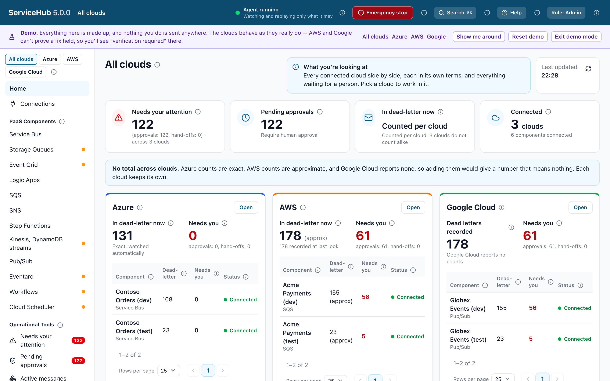
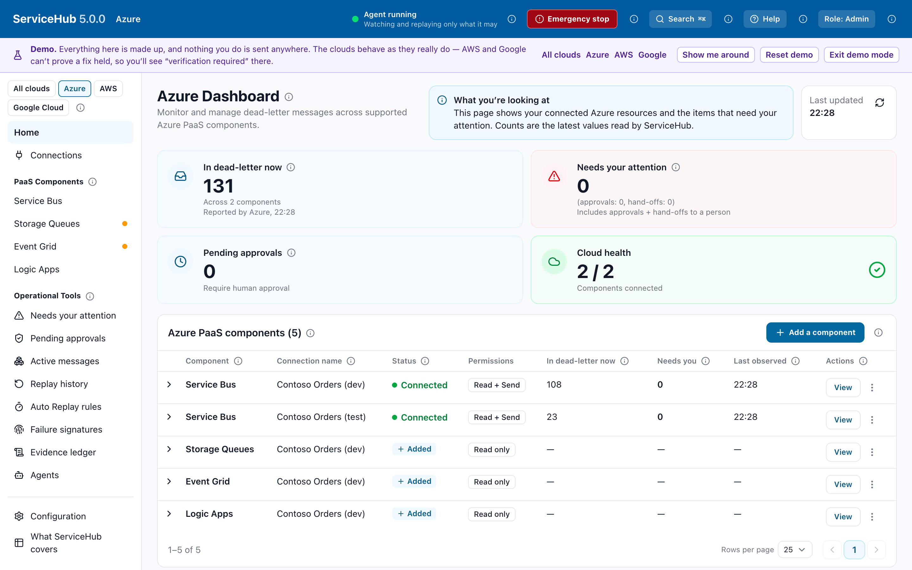
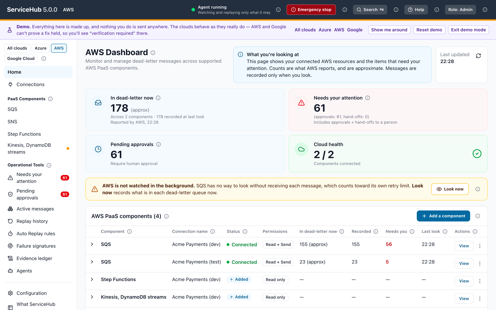
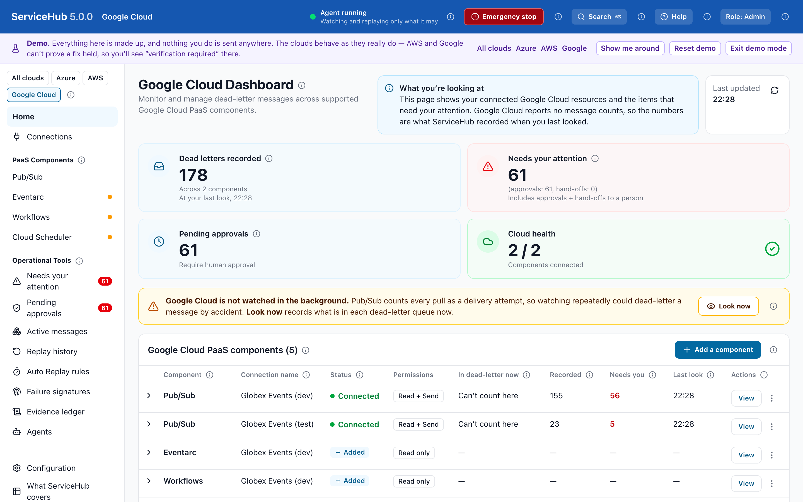
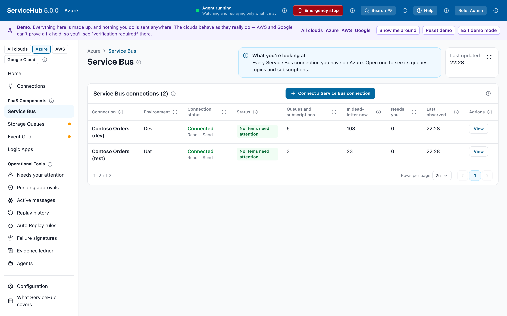
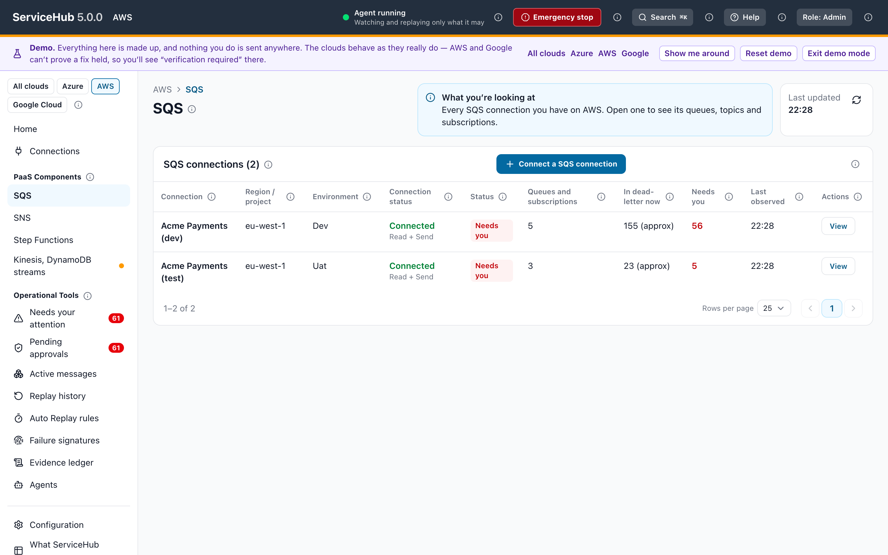
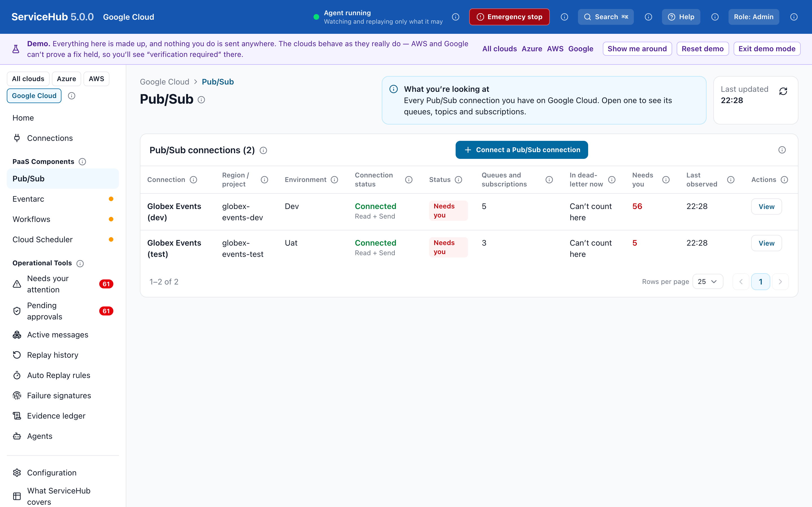
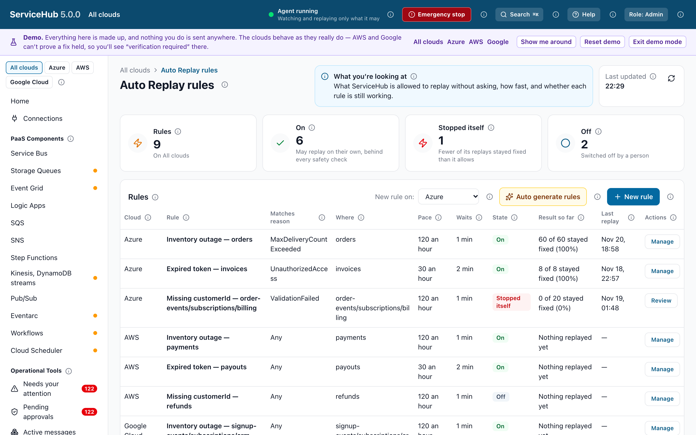
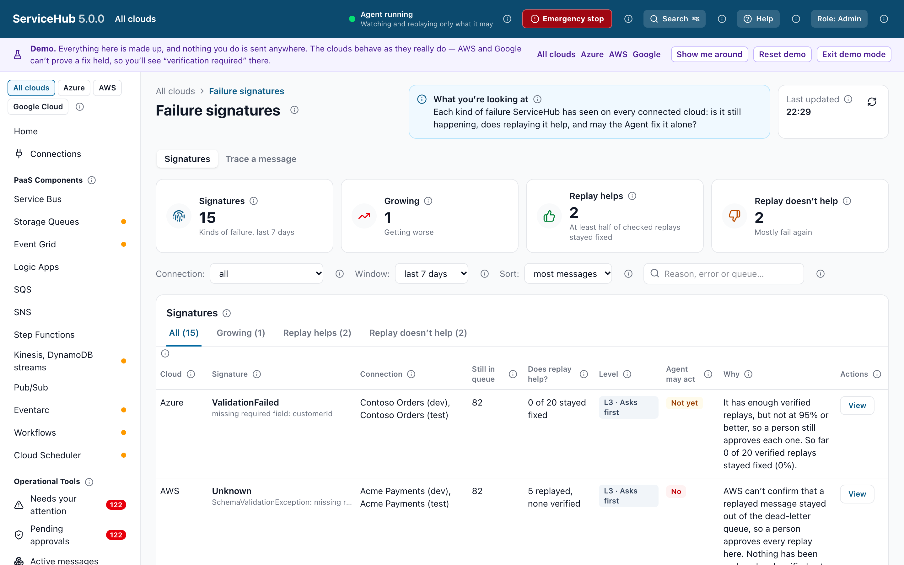
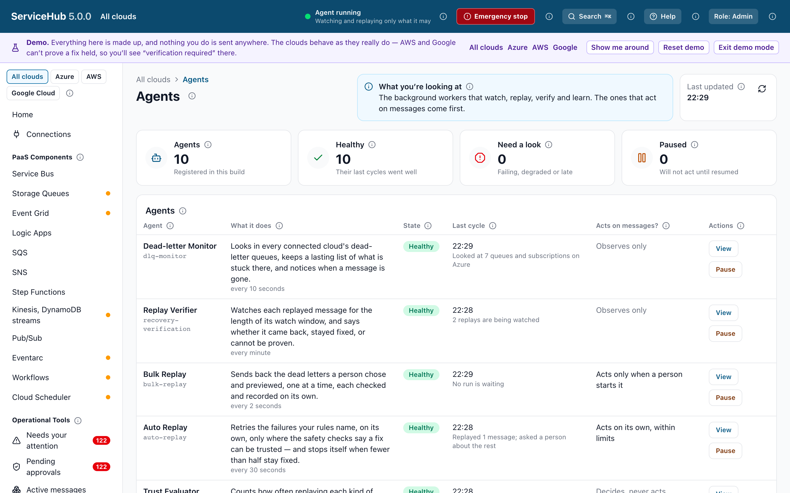

# ServiceHub

**Find out *why* your messages dead-lettered, replay them safely, and see whether the fix held. Azure Service Bus, AWS SQS/SNS and Google Pub/Sub, plus the failed runs of Logic Apps, Step Functions and more, in one place.**

Your queue says "4,218 dead-lettered messages". A count does not tell you which messages, why each failed, or whether replaying them is safe.
ServiceHub shows all three, previews every replay *before* anything is sent back, and keeps a tamper-evident record you can export and verify offline.
One process, one SQLite file, running on your machine.



*Every screenshot on this page is the built-in demo: made-up data, nothing is sent anywhere. You can open the same demo yourself, with no cloud account: **[try it in your browser](https://debdevops.github.io/servicehub/)** (nothing to install) or run it locally in about two minutes, below.*

## The pain, and how ServiceHub resolves it

When a consumer cannot process a message, the cloud retries a few times and then sets it aside in a **dead-letter queue**. That is where the trouble starts.

| The pain | How ServiceHub resolves it |
|---|---|
| **A count, not a story.** The console says "4,218 dead-lettered". Not which, not why. | Groups messages by **why they failed**, and shows each one's body, properties and delivery history. |
| **Replaying is scary.** One wrong script and thousands of messages fail again, or go twice. | **Replay with a preview.** What would be sent, where, and which safety checks ran, shown *before* anything moves. One, a few, or a whole group; always stoppable. |
| **Nobody knows if it worked.** The count dropped, so you assume it did. | **Watches afterwards.** Every replay is marked *Verified*, *Came back* or *Unverified*, in plain words. |
| **Three clouds, three consoles.** | One layout for Azure, AWS and Google Cloud, each in its own terms, each saying honestly what it cannot do. |
| **The same failure, again and again.** | The **Agent** replays a repeat on its own only after that failure has earned trust; until then it stops and asks a person. |
| **"Who replayed that, and why?"** | A tamper-evident **evidence ledger** you can export and verify offline. |

New to queues? Read the **[user guide](docs/USER-GUIDE.md)**: it starts from "what is a dead letter" and walks the whole app in fifteen minutes, with no cloud account.

## Start it

Three ways, from least to most effort. Every one opens the built-in demo first (made-up data), so you can look around before connecting a real cloud.

| | What you do | Needs |
|---|---|---|
| **0. Demo in your browser** | Open **<https://debdevops.github.io/servicehub/>** | Nothing. No install, no cloud account |
| **1. Clone and run** | [`git clone` + `./run.sh`](#option-1-from-source-runsh-does-everything) | git. Everything else is downloaded for you |
| **2. Docker** | [Run the published image](#option-2-docker-no-clone-no-build), or build it from a clone with `docker compose up --build` | Docker |

Which one on which machine:

| Your machine | 1. Clone and run | 2. Docker |
|---|---|---|
| **macOS** | Terminal: `./run.sh` → <http://localhost:3000> | Docker Desktop: bash commands below → <http://localhost:8080> |
| **Linux** | Any shell: `./run.sh` → <http://localhost:3000> | Docker Engine: bash commands below → <http://localhost:8080> |
| **Windows** | PowerShell: `.\run.ps1`. Command Prompt (or double-click): `run.cmd`. No WSL needed → <http://localhost:3000> | Docker Desktop, in PowerShell: [PowerShell commands below](#option-2-docker-no-clone-no-build) → <http://localhost:8080> |
| **Any server or VM** | Same as Linux | Same as Linux, or the [Azure VM guides](docs/HOSTING-AZURE.md) |

Not sure it worked? See [Check it works, and run the tests](#check-it-works-and-run-the-tests) below.

### Option 1. From source: one command does everything

**macOS and Linux** (Terminal):

```bash
git clone https://github.com/debdevops/servicehub.git
cd servicehub
./run.sh
```

**Windows** (PowerShell or Command Prompt). You do not need WSL, administrator rights, or anything installed except **git**:

1. **Get git** if `git --version` says it is not found: `winget install --id Git.Git -e`, or the installer from <https://git-scm.com/download/win>. Open a new window afterwards.
2. **Open PowerShell** (Start menu → type *PowerShell*) or Command Prompt, and go to a short folder such as `C:\src` (very long folder names can break the web packages on Windows).
3. **Run:**

```powershell
cd C:\src
git clone https://github.com/debdevops/servicehub.git
cd servicehub
.\run.ps1          # in PowerShell
run.cmd            # in Command Prompt (also works by double-clicking run.cmd)
```

The first start takes a few minutes: it downloads .NET 10 and Node.js into `%USERPROFILE%\.servicehub\tools` (nothing system-wide; delete that folder to undo it), then builds. When you see **ServiceHub is ready**, open **<http://localhost:3000>**. If Windows Firewall asks about `dotnet` or `node`, **Private networks** is enough. **Ctrl-C** stops everything.

| If | Do |
|---|---|
| PowerShell says *running scripts is disabled* | Use `run.cmd` instead: it runs the same script without changing any setting |
| You want to see what it would install first | `.\run.ps1 -Check` (changes nothing). `-NoInstall` never downloads |
| Port 3000 or 5153 is busy | It picks the next free port and tells you. To choose: `$env:SERVICEHUB_WEB_PORT=3200; .\run.ps1` |
| A download is blocked (company network) | Install [.NET 10](https://dotnet.microsoft.com/download/dotnet/10.0) and [Node.js 22 or 24](https://nodejs.org) yourself, then `.\run.ps1 -NoInstall` |
| It fails | Copy the message; [docs/LOCAL-SETUP.md](docs/LOCAL-SETUP.md) has the manual steps. Or use Docker (Option 2), which needs no .NET or Node |

The Windows script is new in this release and has had less testing than `run.sh`. It does not start the help button (ServiceHub Bot); everything else is the same.

**On macOS and Linux**, `./run.sh` is the whole install. It checks your machine, **downloads the .NET 10 SDK and Node.js if you do not have them** (into `~/.servicehub/tools`, no `sudo`,
nothing system-wide), installs the packages, builds the API and the web app, starts both, and waits until they answer.
It needs only `bash`, `curl` (or `wget`), `tar` and an internet connection.

The first start takes a few minutes while it downloads and compiles. When you see **✔ ServiceHub is ready**, open **<http://localhost:3000>** and choose
**Try it with sample data**. Press **Ctrl-C** to stop everything it started.

| Want to | Run |
|---|---|
| See what it would install, change nothing | `./run.sh --check` |
| Never download anything (you installed .NET and Node yourself) | `./run.sh --no-install` |
| Use other ports | `SERVICEHUB_API_PORT=5200 SERVICEHUB_WEB_PORT=3200 ./run.sh` |
| Keep the data somewhere else | `SERVICEHUB_DATA_DIR=/path/to/folder ./run.sh` |

If port 3000 or 5153 is busy, it picks the next free one and tells you. This mode is for trying and developing (it uses a throw-away encryption key); your data
lives in `services/api/src/ServiceHub.Api/data/`. Prerequisites, what the script does, and a troubleshooting table: **[Local setup guide](docs/LOCAL-SETUP.md)**.

### Option 2. Docker: no clone, no build

Needs [Docker](https://docs.docker.com/get-docker/). The first commands are for a bash shell with `openssl` (macOS, Linux, a cloud VM, or WSL 2); Windows PowerShell is just below.

```bash
# 1. Make an encryption key once, and keep it. It protects the cloud credentials ServiceHub stores.
export SERVICEHUB_ENCRYPTION_KEY="$(openssl rand -hex 32)"

# 2. Download and start (the image is public: no sign-in to pull)
docker run -d --name servicehub --restart unless-stopped \
  -p 127.0.0.1:8080:8080 -v servicehub-data:/data \
  -e SECURITY__ENCRYPTIONKEY="$SERVICEHUB_ENCRYPTION_KEY" \
  ghcr.io/debdevops/servicehub:latest
```

Open **<http://localhost:8080>** and choose **Try it with sample data**. Linux `amd64` and `arm64` (Intel, AMD and Apple silicon) are supported.

**On Windows, in PowerShell** (with [Docker Desktop](https://docs.docker.com/desktop/setup/install/windows-install/) running), the same two steps are:

```powershell
# 1. Make an encryption key once, and keep it.
$bytes = New-Object byte[] 32
[System.Security.Cryptography.RandomNumberGenerator]::Create().GetBytes($bytes)
$env:SERVICEHUB_ENCRYPTION_KEY = -join ($bytes | ForEach-Object { $_.ToString('x2') })

# 2. Download and start
docker run -d --name servicehub --restart unless-stopped `
  -p 127.0.0.1:8080:8080 -v servicehub-data:/data `
  -e SECURITY__ENCRYPTIONKEY=$env:SERVICEHUB_ENCRYPTION_KEY `
  ghcr.io/debdevops/servicehub:latest
```

Write the key down (`$env:SERVICEHUB_ENCRYPTION_KEY`): a new PowerShell window does not remember it, and the saved cloud connections cannot be read without it.

```bash
docker logs -f servicehub     # watch it start
docker stop servicehub        # stop (your data stays in the volume)
docker start servicehub       # start again
```

Pin an exact release for anything you depend on (for example `…/servicehub:5.0.0` instead of `:latest`). To **build the image yourself from a clone** instead:

```bash
git clone https://github.com/debdevops/servicehub.git && cd servicehub
export SERVICEHUB_ENCRYPTION_KEY="$(openssl rand -hex 32)"
docker compose up --build        # → http://localhost:8080 (this machine only)
```

On **Windows PowerShell**, the same build from a clone:

```powershell
git clone https://github.com/debdevops/servicehub.git; cd servicehub
$bytes = New-Object byte[] 32
[System.Security.Cryptography.RandomNumberGenerator]::Create().GetBytes($bytes)
$env:SERVICEHUB_ENCRYPTION_KEY = -join ($bytes | ForEach-Object { $_.ToString('x2') })
docker compose up --build
```

The first build takes a few minutes (it builds the web app and the API inside the image). `docker compose down` stops it; the data stays in the `servicehub-data` volume.

ServiceHub **refuses to start in Production without an encryption key**, and losing the key makes saved cloud connections unreadable, so keep it in a password manager.
Updating, backing up, removing and fixing problems: **[Run ServiceHub with Docker](docs/DOCKER.md)**.

### Check it works, and run the tests

| | macOS / Linux | Windows PowerShell |
|---|---|---|
| Is it up? | `curl -s http://localhost:3000/health/ready` (says `Healthy`) | `curl.exe -s http://localhost:3000/health/ready` (`run.ps1`), or `:8080` (Docker) |
| What would it install? | `./run.sh --check` (changes nothing) | `.\run.ps1 -Check` |
| Fast test run (about 1 minute) | `./runtest.sh --quick` | contributors: run it inside WSL 2 (`runtest.sh` is a bash script) |
| Everything CI runs (about 12 minutes) | `./runtest.sh --all` | contributors: run it inside WSL 2 (`runtest.sh` is a bash script) |
| Stop | Ctrl-C | Ctrl-C (`run.ps1`), or `docker stop servicehub` |

What the test run needs and what each flag covers: **[Local setup guide](docs/LOCAL-SETUP.md)** and [tests/README.md](tests/README.md).

## Connect your cloud, step by step

Each guide starts in the cloud's own console (where to click, what to create, what to copy), then walks ServiceHub screen by screen with **annotated screenshots**: every number on a picture is explained underneath it, including what the control will *not* do. The same guides are in the app under **Help**.

| | Azure | AWS | Google Cloud |
|---|---|---|---|
| **Service** | Service Bus | SQS and SNS | Pub/Sub |
| **You give ServiceHub** | A connection string from a ServiceHub-only policy | An access key for a ServiceHub-only IAM user | A service-account key file |
| **Counts dead letters** | Exactly, in the background | Approximately; you press **Look now** | No counts; you press **Look now** |
| **Can prove a fix held** | Yes | After you switch on fix-confirming | After you switch on fix-confirming |
| **Guide** | **[Azure guide](docs/clouds/azure.md)** | **[AWS guide](docs/clouds/aws.md)** | **[Google Cloud guide](docs/clouds/gcp.md)** |

Each guide has: **Part 1** the cloud console, **Part 2** connect, **Part 3** where everything is, **Part 4** find, understand and replay a dead letter, **Part 5** approvals, **Part 6** what happened afterwards, **Part 7** the Agent and rules, **Part 8** configuration, help and the emergency stop, then troubleshooting and cleanup.

## What it looks like, on each cloud

Same app, three clouds. Each cloud says what it can and cannot do there, honestly: whether ServiceHub can count dead letters, and whether it can confirm a fix held.

| | Azure | AWS | Google Cloud |
|---|---|---|---|
| **Home** |  |  |  |
| **Dead letters** |  |  |  |
| **Step-by-step guide** | [Azure guide](docs/clouds/azure.md) | [AWS guide](docs/clouds/aws.md) | [Google Cloud guide](docs/clouds/gcp.md) |

## What you get

One layout: a menu on the left, the page on the right, and the cloud you are looking at in the address (`/azure`, `/aws`, `/gcp`, or all of them). A link shows someone exactly what you see.

- **See what needs you**: Home for every connected cloud, with what is dead-lettered now, what is waiting for a decision, and how each connection is doing.
- **Understand a failure**: open a dead letter, read why it failed, and see its body, properties and delivery history.
- **Replay with a preview**: one message or the ones you tick. Always previewed first (how many, what risk, which checks ran) and always stoppable.
- **Know whether it held**: a replayed message is watched afterwards and marked *verified* or *came back*.
- **Let the Agent handle repeats, only when it has earned it**: Auto Replay rules replay a failure on their own only after enough verified fixes, and stop and ask a person when results turn bad.
- **Plug components in and out**: tick a component (Logic Apps, Event Grid, Step Functions, Kinesis and DynamoDB streams, Workflows, Eventarc, Cloud Scheduler) on a connection to list its failed runs or dead-lettered events; untick it to take it out of the menu. Its access is checked, read-only, before it is added. Unticking keeps every record it produced.



**Operational Tools** in the menu are the same for every cloud: Needs your attention, Pending approvals, Active messages, Replay history, Auto Replay rules, **Failure signatures** (failures grouped by how they fail), the **Evidence ledger** and **Agents**.

| Failure signatures | Agents |
|---|---|
|  |  |

## Watch it, on each cloud

Working in Azure, AWS or Google Cloud and never seen ServiceHub? Start with the short clip for your cloud. Recorded on ServiceHub 5.0.0 against real development clouds, with captions so they work with the sound off.

- **Short clip** (about two minutes): *where the pain is* (a count and no story; replaying blind; nobody knows if it worked; the same failure again and again) and *what ServiceHub gives you*: the message list grouped by why it failed, one message in detail, a replay with a preview, proof afterwards, and the Agent that replays repeats on its own only once it has earned the right.
- **Full clip** (about six minutes): every PaaS component of that cloud and every function: Connections, Add a component, each component's own page, the message list, a message, a real single replay, the bulk preview, every tab, all eight Operational Tools, rules, signatures, the evidence ledger, agents, how autonomy is earned, security, Configuration, Coverage, Help, Search and the Emergency stop (opened and closed, never confirmed). A slow read of the cloud is sped up and says so.

| | Azure | AWS | Google Cloud |
|:---:|:---:|:---:|:---:|
| **Components in the full clip** | Service Bus, Storage Queues, Event Grid, Logic Apps | SQS, SNS, Step Functions, Kinesis and DynamoDB streams | Pub/Sub, Eventarc, Workflows |
| **What the short clip stresses** | Exact counts, watched automatically, and a replay it can prove held | It never looks on its own, and says why | No counts, often no reason, and it says so plainly |
| **Short clip** | [](docs/media/azure-short.mp4) | [](docs/media/aws-short.mp4) | [](docs/media/gcp-short.mp4) |
| **Play** | [▶ Short, 1:39](docs/media/azure-short.mp4) · [▶ Full, 6:35](docs/media/azure-full.mp4) | [▶ Short, 1:56](docs/media/aws-short.mp4) · [▶ Full, 6:22](docs/media/aws-full.mp4) | [▶ Short, 1:53](docs/media/gcp-short.mp4) · [▶ Full, 6:26](docs/media/gcp-full.mp4) |

## What it covers

Each row is one place a message gets stuck, and what ServiceHub can do about it. **Supported** rows have been run against a real cloud.
**Being validated** rows are built and read-only, but have not yet had that live run: treat them as a way to *see* failures, not to act on them.
This table is generated from the code, and a test fails if it drifts.

<!-- coverage-table:start -->
| Cloud | Component | Where it gets stuck | Found by | Moves on by | Status | Note |
|---|---|---|---|---|---|---|
| Azure | Service Bus | Dead-letter queue | Reads the place that holds the failed message | ServiceHub replays one message and verifies it | Supported | Can reach Verified |
| Azure | Service Bus | Transfer dead-letter queue | Reads the place that holds the failed message | Shown as a count; reading it is being validated | Being validated | Replay target needs a live check |
| Azure | Service Bus | Deferred messages, stuck sessions | A metric or a state only | Handed to a person | Being validated | No replay offered |
| Azure | Storage Queues | Poison queue | Reads the failed records the service keeps | Handed to a person | Being validated | Not yet validated: read only. A message in a poison queue (a queue named *-poison) is listed with when it arrived and how often it was tried; its text is never read. Needs an Azure connection that signs in with Entra |
| Azure | Event Grid | Dead-letter blobs | Reads the failed records the service keeps | Handed to a person | Being validated | Read only: the reason and delivery attempts of each dead-lettered event. ServiceHub cannot retry these: Event Grid has no way to redeliver an event, and republishing one to the topic would reach every subscription. Needs an Azure connection that signs in with Entra |
| Azure | Logic Apps | Failed runs | Reads the failed runs | A person asks Azure to resubmit the run | Supported | Failed, timed-out and cancelled runs. A resubmit starts a new run from the trigger and every step runs again, including steps that already succeeded; the original run stays Failed. Ends Unverified. Needs an Azure connection that signs in with Entra |
| Azure | Event Hubs, Stream Analytics, Data Factory, Synapse, IoT Hub | No failed copy is kept | A metric or a state only | Not supported | Not supported | Only a lag or job metric exists; your monitoring already alerts on it |
| Azure | Function Apps, Container Apps, AKS, Web Apps, App Service | Not a message store | — | Not supported | Not supported | They are consumers; their failures reach ServiceHub through the queue they read |
| Azure | Cosmos DB, Azure SQL, Storage Accounts, Data Lake, Key Vault, API Management | Not messaging | — | Not supported | Not supported | No message, so nothing to put back |
| AWS | SQS | Dead-letter queue | Reads the place that holds the failed message | ServiceHub replays one message, on approval | Supported | Ends Unverified |
| AWS | SQS | Ageing source queue | A metric or a state only | Handed to a person | Being validated | No replay offered |
| AWS | SNS | Dead-letter queue of each subscriber queue | Reads the place that holds the failed message | ServiceHub replays to the one subscriber queue | Supported | Queue subscribers only. Ends Unverified |
| AWS | Lambda, EventBridge | Dead letters that land in SQS | Reads the place that holds the failed message | Reason shown; replay on request | Being validated | Read as SQS dead letters |
| AWS | Step Functions | Failed runs | Reads the failed runs | A person asks AWS to redrive the run | Supported | Failed, timed-out and aborted Standard runs; AWS restarts the run from the step that failed. Ends Unverified. Express runs are not listed |
| AWS | Kinesis, DynamoDB streams | Failure records point at the original | Reads the failed records the service keeps | Handed to a person | Being validated | Read only: where a failed batch was in the stream. The original record expires, and may already be gone |
| AWS | Data Firehose, MSK, Amazon MQ | No failed copy, or a connected broker | A metric or a state only | Not supported | Not supported | Brokers are out of scope |
| AWS | ECS, EKS, S3, DynamoDB, RDS, ElastiCache, API Gateway | Not messaging | — | Not supported | Not supported | No message, so nothing to put back |
| Google Cloud | Pub/Sub | Dead-letter topic of each subscription | Reads the place that holds the failed message | ServiceHub puts one message back on its topic, on approval | Supported | No counts. Every subscription on that topic receives it again. Ends Unverified |
| Google Cloud | Pub/Sub | Backlog, oldest unacked age | A metric or a state only | Handed to a person | Being validated | No replay offered |
| Google Cloud | Eventarc | Undelivered events | Reads the failed records the service keeps | A person retries it in Pub/Sub | Being validated | Read only: events held in a trigger's dead-letter topic. Retry one in Pub/Sub, which puts it back on the topic this trigger reads from; every subscription on that topic receives it again. A trigger with no dead-letter policy keeps nothing |
| Google Cloud | Workflows | Failed runs | Reads the failed runs | Handed to a person | Being validated | Read only: failed and cancelled runs. Re-run in the Google Cloud console |
| Google Cloud | Cloud Scheduler | Jobs whose last attempt failed | Reads the failed runs | Detected, handed to an owner | Being validated | Read only: the last attempt of each job, not a history. A job that failed and then succeeded shows nothing. A paused job is listed, never counted as failed |
| Google Cloud | Dataflow, Dataproc, BigQuery, Cloud Tasks | No failed copy is kept | A metric or a state only | Not supported | Not supported | Only a job or lag metric exists |
| Google Cloud | Cloud Functions, Cloud Run, GKE, Cloud Storage, Firestore, Spanner, Apigee | Not messaging | — | Not supported | Not supported | No message, so nothing to put back |
<!-- coverage-table:end -->

## Know the limits

- **Production namespaces are read-only for replay.** Replay is refused on any namespace you mark as Production, and ServiceHub has no way to override that. Investigate there; replay in dev and staging.
- **Azure is the verified path.** Only Azure can confirm a replayed message stayed fixed out of the box. AWS and Google read "verification required" until you switch on fix-confirming per connection (the connection's Configuration tab), which gives ServiceHub a complete view of that cloud's dead-letter queue. GCP often records no failure reason.
- **Anyone who can reach its port is the admin.** Keep it on `localhost`.
- **Message content is stored unencrypted.** The first 500 characters of each dead-letter body, its properties and a hash are kept in the SQLite file ([SECURITY.md](SECURITY.md)), so treat the data folder like the queue. Cloud credentials and webhook URLs are encrypted.
- **No upgrade from 4.0.0.** 4.1.0 and later are a from-scratch rewrite with a fresh database. Run it beside 4.0.0 and connect your clouds again. 4.0.0 lives, frozen, in [`archive/servicehub-4.0.0/`](archive/servicehub-4.0.0/). See the [changelog](CHANGELOG.md).

## How it stays safe

- **A person decides by default.** The Agent replays on its own only for a failure it has earned trust on; otherwise it stops and asks. Every replay, human or automatic, goes through one gate that **fails closed**: a check that cannot run blocks the replay.
- **Honest about each cloud.** Where a cloud cannot prove a fix held, results read *"verification required"*, never *"verified"*.
- **Emergency stop.** Stops everything ServiceHub does on its own, rules and Agent alike. Switching it on needs a reason and the typed word `STOP`; lifting it, a reason and `LIFT`. Both are recorded.
- **Evidence you can check offline.** Every recovery action is appended to a hash-chained ledger. Export it and verify it without ServiceHub: `python3 scripts/verify-recovery-chain.py <export.json>`. See [Recovery Evidence](docs/RECOVERY-EVIDENCE.md).
- **Credentials are encrypted at rest** (AES-GCM) and the key can be rotated: [Encryption key rotation](docs/ENCRYPTION-KEY-ROTATION.md).

## Deploying it for real

- **One instance.** One process, one SQLite file; a second instance on the same data directory exits. Keep the file on local block storage, not a network share.
- **Where to run it.** Step by step on a small Azure VM: **[CLI guide](docs/HOSTING-AZURE-CLI.md)** or **[Portal guide](docs/HOSTING-AZURE-PORTAL.md)** (the full runbook is [Host ServiceHub on Azure](docs/HOSTING-AZURE.md)). Considering Azure App Service instead? Read **[App Service: should you?](docs/HOSTING-AZURE-APP-SERVICE.md)** first; it is less safe for ServiceHub than a VM. Terraform for Azure, AWS and Google Cloud (a private VM, no open port, daily snapshots) is in [`infra/`](infra/README.md); it has not yet been run against a real account.
- **Data and backups.** Set `ServiceHub__DataDirectory` (the Docker image uses `/data`). Back up from Configuration → Backup: [Backup & restore](docs/BACKUP-RESTORE.md).
- **Who is asking.** ServiceHub does not log the browser in. Keep it on `localhost` or put it behind a private network or an authenticating reverse proxy. It can give other people and automation *limited* access with API keys (`X-API-KEY`), OIDC or Azure Easy Auth, plus Viewer, Operator and Admin roles. It answers only to `localhost`, `127.0.0.1` and `[::1]`; reaching it by another name needs `AllowedHosts` set (keep `localhost` in it). See [SECURITY.md](SECURITY.md).
- **Cloud permissions.** Read/receive on the queues you want watched; send and delete only if you want to replay and purge. Prefer identity-based auth (managed identity, IAM role, workload identity) over long-lived secrets.

## Documentation

| | |
|---|---|
| [Local setup](docs/LOCAL-SETUP.md) | Install, run, check and troubleshoot on your own machine, with or without Docker |
| [Run with Docker](docs/DOCKER.md) | Run the public image, update it, back it up, fix problems |
| [User guide](docs/USER-GUIDE.md) | For a novice: the problem, the map of the app, a fifteen-minute first run, a glossary |
| [Azure](docs/clouds/azure.md) · [AWS](docs/clouds/aws.md) · [Google Cloud](docs/clouds/gcp.md) | Step-by-step setup and use, from the cloud console to the replay result, with annotated screenshots of ServiceHub 5.0.0 (also in the app under **Help**) |
| [Hosting on Azure](docs/HOSTING-AZURE.md) | Run it always-on on an Azure VM, safely (the full runbook) |
| [Azure VM, CLI](docs/HOSTING-AZURE-CLI.md) | The short version, in a terminal |
| [Azure VM, Portal](docs/HOSTING-AZURE-PORTAL.md) | The short version, by clicking |
| [Azure App Service](docs/HOSTING-AZURE-APP-SERVICE.md) | Whether to use it, and the hardened setup if you do |
| [Backup & restore](docs/BACKUP-RESTORE.md) | Take, verify and restore a backup |
| [Encryption key rotation](docs/ENCRYPTION-KEY-ROTATION.md) | Rotate the key that protects stored credentials, and what to do if it leaks |
| [Recovery Evidence](docs/RECOVERY-EVIDENCE.md) | The hash-chained ledger and how an auditor verifies an export |
| [Adding a provider](docs/extending/adding-a-provider.md) · [Adding an agent](docs/extending/adding-an-agent.md) | For engineers extending ServiceHub |
| [MCP server](tools/mcp/README.md) | A read-only way for an AI assistant to ask ServiceHub about dead letters |
| [Tests](tests/README.md) · [Contributing](CONTRIBUTING.md) · [Security](SECURITY.md) · [Changelog](CHANGELOG.md) | |

## Contributing

```bash
./runtest.sh --all     # everything CI runs: lint, type-check, backend + frontend suites with 60 % floors, browser tests, guards
```

See [CONTRIBUTING.md](CONTRIBUTING.md). Licensed under the [MIT License](LICENSE).
