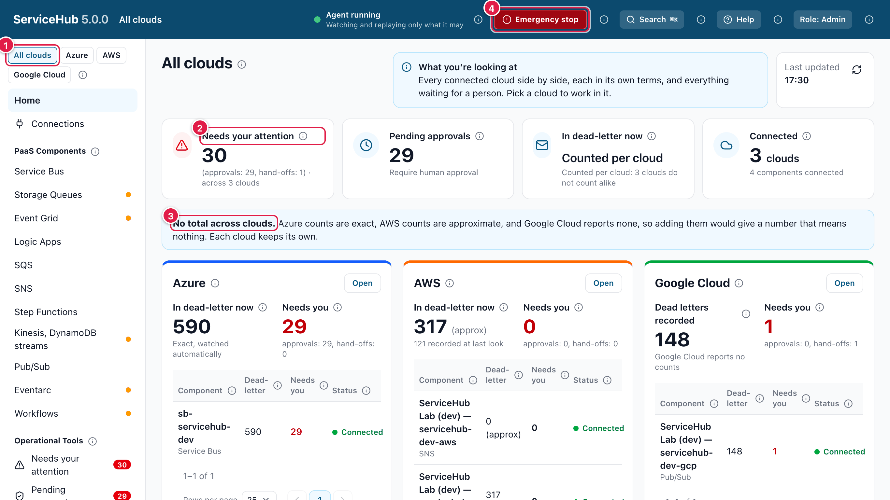

# ServiceHub user guide

> **Who this is for:** someone who has never used ServiceHub, and may be new to message queues too. Every word is explained the first time it appears.
> **Time:** 15 minutes, and you need no cloud account: the built-in demo has made-up data.
> **Version:** 5.0.0.

## 1. The problem, in plain words

Your systems talk to each other by leaving **messages** in a **queue**, like notes in a letterbox. A *consumer* picks each note up and acts on it: charge a card, ship an order, send an email.

Sometimes it cannot. The note is malformed, a service it needs is down, or a bug throws an error. The cloud tries again a few times. Then it gives up and puts the note in a side box called the **dead-letter queue** (a "dead letter" is a message nobody could handle).

Then three things go wrong, every time:

| The pain | What you see in the cloud's own console | What ServiceHub does about it |
|---|---|---|
| **A count, not a story.** | "4,218 dead-lettered messages." Not which ones, not why. | Groups them by **why they failed** (the reason the cloud recorded) and shows the body, properties and delivery history of each. |
| **Replaying is scary.** | You write a script, hope the cause is fixed, and send thousands of messages back. If you are wrong they all fail again and you made it worse. | **Replay with a preview.** It shows what would be sent, where, and which safety checks ran, before anything moves. One message, the ones you tick, or all of a group, and always stoppable. |
| **Nobody knows if it worked.** | The count went down, so you assume it did. A replayed message might be back in the dead-letter queue ten minutes later. | **It watches afterwards.** Every replay is marked **Verified** (it did not come back), **Came back** (it failed again) or **Unverified** (this cloud cannot prove it either way), in plain words. |
| **Three clouds, three consoles, three vocabularies.** | Azure Service Bus, AWS SQS and Google Pub/Sub each work differently. | One layout. Each cloud is shown in its **own terms** and says honestly what it cannot do. |
| **Repeats eat your day.** | The same failure, over and over, each needing the same fix. | An **Agent** can replay a repeat on its own, but **only after that kind of failure has earned trust** with enough verified fixes. Until then it stops and asks a person. |
| **"Who replayed that, and why?"** | No record. | A tamper-evident **evidence ledger** records every decision. You can export it and check it offline. |

## 2. Start it and open the demo

Pick the one that matches your machine. All of them end at the same screen. Full detail, troubleshooting and settings are in the [local setup guide](LOCAL-SETUP.md).

| Your machine | Run | Open |
|---|---|---|
| **macOS** or **Linux** | `git clone https://github.com/debdevops/servicehub.git && cd servicehub && ./run.sh` | <http://localhost:3000> |
| **Windows** | Open **WSL 2** (Ubuntu), then run the same commands as Linux inside it. Or use Docker (below). | <http://localhost:3000> |
| **Any machine with Docker** | See the [Docker guide](DOCKER.md) | <http://localhost:8080> |

Nothing to install first: `./run.sh` downloads .NET and Node into `~/.servicehub/tools` if you do not have them. When it prints **ServiceHub is ready**, open the address. On a screen with nothing connected, choose **Try it with sample data**.

## 3. The map: where is what

Everything is in **one layout**: a menu on the left, a page on the right, and a bar across the top. The cloud you are looking at is the first part of the address (`/azure`, `/aws`, `/gcp`, or all of them), so you can send someone a link and they see what you see.

**The top bar**

| Control | What it does |
|---|---|
| **Agent running** | The Agent is on. It only replays what it has earned the right to. Hover the (i) for the exact rules. |
| **Emergency stop** | Switches off everything ServiceHub does *on its own*. Needs a reason and the word `STOP`. A replay a person starts still works. |
| **Search** (`⌘K` / `Ctrl-K`) | Find a connection, a queue, a page or an action. It never searches inside messages. |
| **Help** (`?`) | Answers by task, the step-by-step guides for each cloud, and the shortcuts. |
| **Role** | What you may do: **Viewer** sees everything; **Operator** may replay; **Approver** may also approve what the Agent asked and change rules; **Admin** also manages connections, access, backups and the emergency stop. |

**The left menu**

| Group | Pages | Use it to |
|---|---|---|
| (top) | **Home**, **Connections** | See every cloud at a glance; connect or remove a cloud |
| **PaaS Components** | Service Bus, SQS, Pub/Sub, Logic Apps, Step Functions… | Open one cloud service and its connection. An amber dot means "built, not yet proven against a real cloud" |
| **Operational Tools** | **Needs your attention**, **Pending approvals**, **Active messages**, **Replay history**, **Auto Replay rules**, **Failure signatures**, **Evidence ledger**, **Agents** | The pages you use every day. The same on every cloud |
| (bottom) | **Configuration**, **What ServiceHub covers** | Settings, backup, access; what is supported on which cloud |

The **(i)** icons are everywhere on purpose. Hover or focus one to read what that heading, column or control means.

## 4. Your first fifteen minutes (in the demo)

1. **Look at Home.** The tiles say what needs you, what is dead-lettered, what is waiting for approval. Notice there is *no total across clouds*: one cloud counts exactly, one roughly, one not at all, so adding them would be meaningless.
2. **Open a cloud.** Use the switcher at the top left, or press **Open** on a cloud's card.
3. **Open a connection.** In the menu choose *Service Bus*, *SQS* or *Pub/Sub*, then the connection. Choose the **Dead-letter messages** tab.
4. **Open a message.** Press **Open** on a row. **Why it failed** says what the cloud recorded. **Body**, **Properties**, **History** are the message exactly as stored. ServiceHub never changes it.
5. **Preview a replay.** Press **Replay…** (or `R`). Read the preview: where it goes, which checks ran. Press **Cancel**. Nothing moved.
6. **Replay it for real** (in the demo nothing is sent anywhere). Press **Replay 1 message**. Then open **Replay history** and find the outcome words **Watching**, **Verified**, **Came back**.
7. **Meet the Agent's questions.** Open **Pending approvals**. Each row is a replay the Agent *wanted* to do and stopped on. **Review** it, then **Approve** or **Decline…** (a reason is required to decline).
8. **See what is learned.** **Failure signatures** groups failures by how they fail. **Auto Replay rules** shows what the Agent may do by itself.
9. **Find the safety switch.** Open **Emergency stop** to read what it stops, then close it without switching anything on.

## 5. I want to…

| I want to | Go to | Notes |
|---|---|---|
| See why a message failed | Connection → **Dead-letter messages** → **Open** | Reason, description, body, history |
| Replay one message | Open it → **Replay…** → preview → **Replay 1 message** | Needs the Operator role |
| Replay several | Tick them → **Replay selected…** | A preview opens first |
| Know if a replay worked | **Replay history**, or the connection's **Recovery** tab | Verified / Watching / Came back / Unverified |
| See what is waiting for a person | **Needs your attention** or **Pending approvals** | The number in the menu is the same number |
| Approve or decline an Agent proposal | **Pending approvals** → **Review** | Needs the Approver role |
| Let the Agent handle a repeat failure | **Auto Replay rules** → **New rule** | A rule only acts once that failure has earned trust |
| Stop everything automatic now | **Emergency stop** (top bar) | Reason + type `STOP` |
| Connect a cloud | **Connections** → **Connect a cloud** | Per-cloud steps: [Azure](clouds/azure.md), [AWS](clouds/aws.md), [Google Cloud](clouds/gcp.md) |
| Add Logic Apps, Step Functions, Eventarc… | **Add a component** (Connections or the connection page) | Access is checked read-only first |
| Take a backup | **Configuration → Backup** | [Backup and restore](BACKUP-RESTORE.md) |
| Prove the record was not altered | **Evidence ledger** → export, then `python3 scripts/verify-recovery-chain.py <export.json>` | [Recovery evidence](RECOVERY-EVIDENCE.md) |

## 6. Words you will meet

| Word | Meaning |
|---|---|
| **Queue** | A line of messages waiting for a consumer. |
| **Topic and subscription** | A topic broadcasts; each subscription gets its own copy and its own line. |
| **Dead letter** | A message the cloud gave up delivering. It is set aside, not deleted. |
| **Replay** | Putting a dead-lettered message back where it came from so it is processed again. |
| **Preview** | What a replay would do, shown before anything is sent. |
| **Verified / Came back / Unverified / Watching** | What ServiceHub saw after a replay: it held, it failed again, this cloud cannot prove it, or it is still being watched. |
| **Look now** | On AWS and Google Cloud ServiceHub cannot count dead letters without receiving them (which uses up a retry). So it records them when you press Look now, never in the background. |
| **Signature** | A group of failures that fail the same way. |
| **Agent** | The background worker that watches, and replays only what it has earned. |
| **Hand-off** | A failure ServiceHub cannot or should not fix itself, passed to a person. |
| **Ledger** | The tamper-evident record of every decision. |

## 7. Safe by design

- A person decides by default. The Agent acts alone only on a failure that has earned trust.
- Every replay, by a person or the Agent, goes through one safety gate. If a check cannot run, the replay is **blocked**, never allowed.
- A connection marked **Production** is read-only for replay.
- Credentials are encrypted at rest. ServiceHub never shows them again.
- ServiceHub does not log the browser in: **anyone who can reach its port is the Admin.** Keep it on `localhost`, or behind a private network or an authenticating proxy.

## 8. Keyboard

| Key | Does |
|---|---|
| `⌘K` or `Ctrl-K` | Search |
| `?` | Help |
| `R` | Replay the open message (preview first) |
| `/` | Jump to the list's search box |
| `Esc` | Close a window |

## 9. Where next

- Connect your own cloud: [Azure](clouds/azure.md) · [AWS](clouds/aws.md) · [Google Cloud](clouds/gcp.md), each with annotated screenshots from the cloud's console to the replay result.
- Run it always-on: [Docker](DOCKER.md) or [Azure VM](HOSTING-AZURE.md).
- Something wrong: [local setup troubleshooting](LOCAL-SETUP.md) and [SECURITY.md](../SECURITY.md).
