# ServiceHub on AWS SQS — step by step, with real screenshots

> **Prefer to watch?** A captioned walkthrough of every screen, about six minutes: [AWS SQS full video](../media/aws-full.mp4). Short on time? The pain and what ServiceHub gives you, in about two minutes: [short video](../media/aws-short.mp4).

This guide takes you from nothing to a working ServiceHub on **AWS SQS**, one screen at a time. Every picture is the real
application (or the real AWS console) — not a mock-up — with numbered markers; the numbered list under each picture says what that control
does **and what it will not do**. Account ids and the access key are blanked out in the console pictures.

**What you will do**

1. In the AWS console, make a user just for ServiceHub, limited to your queues, and create an access key for it.
2. Connect AWS in ServiceHub and check it can see your queues.
3. Ask ServiceHub to look at the dead letters, understand why they failed, and replay one safely.
4. See what ServiceHub can and cannot prove on AWS, and learn what Auto Replay, the Evidence ledger and Configuration show.

**What you need**

| You need | Why |
|---|---|
| One or more SQS queues, ideally with a **dead-letter queue** (a redrive policy) | The dead-letter queue is where failed messages wait for ServiceHub |
| Permission in AWS to create an IAM user and an access key | You will make a ServiceHub-only credential |
| ServiceHub running (see the README) | You will open it in a browser |

> **Cost, and the one thing that is different on AWS.** SQS has no way to look at a message without *receiving* it, and every receive counts as a
> delivery attempt. So ServiceHub **never looks on its own**: it counts messages for free, and reads dead letters only when you press
> **Look now** (up to 100 per queue, handed straight back). It does not browse your active messages at all. Normal SQS request charges apply;
> ServiceHub adds none of its own.

**The permissions policy** (replace `ACCOUNT_ID` and the region and queue names with yours). Nothing outside these two queues is reachable:

```json
{
  "Version": "2012-10-17",
  "Statement": [
    { "Sid": "ListQueues", "Effect": "Allow", "Action": "sqs:ListQueues", "Resource": "*" },
    { "Sid": "WatchAndReplay", "Effect": "Allow",
      "Action": ["sqs:GetQueueUrl", "sqs:GetQueueAttributes", "sqs:ReceiveMessage",
                 "sqs:ChangeMessageVisibility", "sqs:SendMessage", "sqs:DeleteMessage"],
      "Resource": ["arn:aws:sqs:ap-south-1:ACCOUNT_ID:servicehub-dev-orders",
                   "arn:aws:sqs:ap-south-1:ACCOUNT_ID:servicehub-dev-orders-dlq"] }
  ]
}
```

Why each action: `ListQueues` finds your queues; `GetQueueUrl` and `GetQueueAttributes` read counts; `ReceiveMessage` is the look;
`ChangeMessageVisibility` hands a looked-at message straight back; `SendMessage` and `DeleteMessage` are used only when you replay.


---


## Part 1 — In the AWS console

*Do these first. Each step shows the real console.*


### 1.1 Look at your queues

Sign in to the AWS console, search for **SQS** and open **Queues**. Note the **region** (top right): queues belong to a region, and you will choose the same one in ServiceHub. The **Messages available** column is what ServiceHub will count.


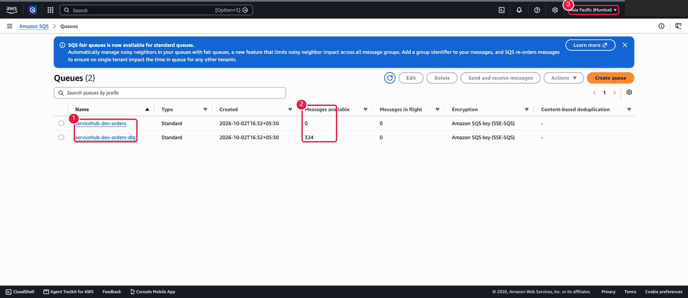


1. Queue names — your orders queue and its dead-letter queue (the one ending -dlq). ServiceHub finds every queue in the region; you do not list them.
2. Messages available — waiting to be received. The dead-letter queue's number is what ServiceHub counts as dead letters (here 324).
3. Region — queues belong to a region. You choose the same region in ServiceHub when you connect (here Asia Pacific (Mumbai), ap-south-1).


### 1.2 Find the dead-letter queue

Open your main queue and choose the **Dead-letter queue** tab. It names the queue that receives failures and the **Maximum receives** — how many tries before SQS moves a message there. If a queue has no dead-letter queue, failed messages are retried until they expire and ServiceHub has nothing to show.


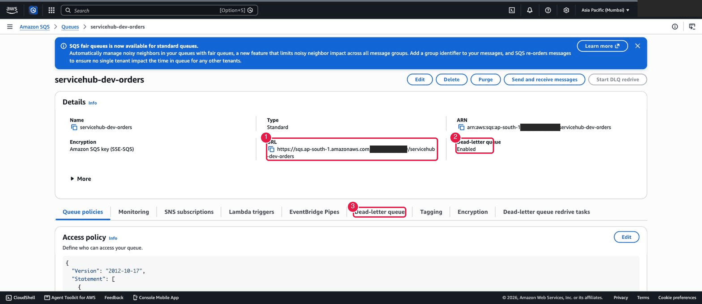


1. URL — the address of this queue. ServiceHub builds it for you from the queue's name and your region.
2. Dead-letter queue — Enabled: a message that fails too often is moved to a second queue instead of being lost.
3. Dead-letter queue tab — shows which queue receives the failures (next screenshot).


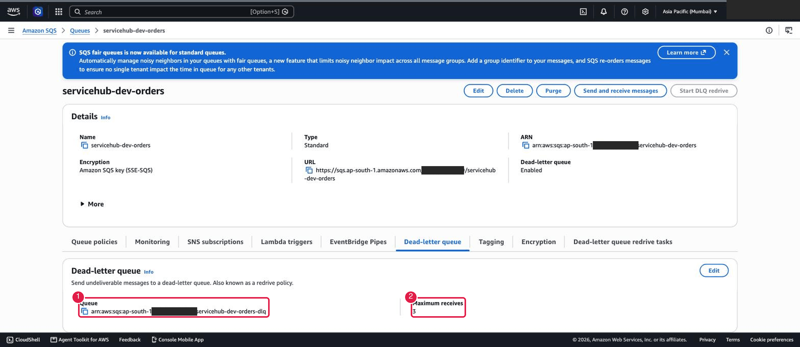


1. Queue — the dead-letter queue that receives the failures. ServiceHub reads this one to show Dead letters.
2. Maximum receives — 3: after three failed tries SQS moves the message here. Reading a dead letter from ServiceHub counts as one more receive, which is why ServiceHub only looks when you ask.


### 1.3 Create a ServiceHub-only user

Open **IAM → Users → Create user**. Name it (we use `servicehub-app`), leave **console access** off — it is for programs only — and give it no groups. Do not use your own user or the root account: a separate user can be switched off later without disturbing anything else.


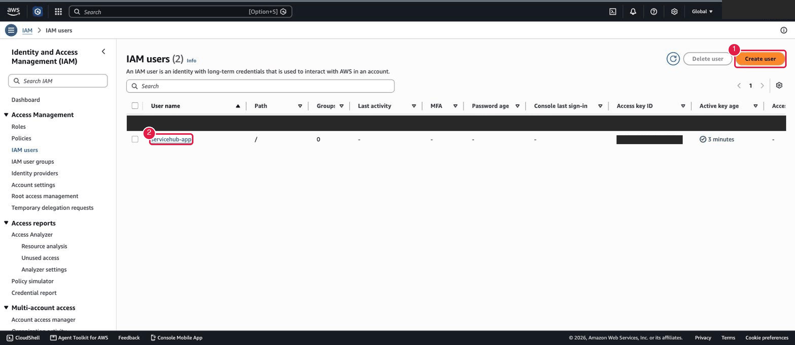


1. Create user — start here to make a user just for ServiceHub, not your own.
2. The ServiceHub user — separate from your own, so you can switch it off later without disturbing anything else.


### 1.4 Give it only the SQS permissions it needs

On the user, **Add permissions → Create inline policy**, choose JSON, and paste the policy from the start of this guide with your queue names. The user then has exactly one policy, limited to your queues: if its key ever leaked, it could touch nothing else in your account.


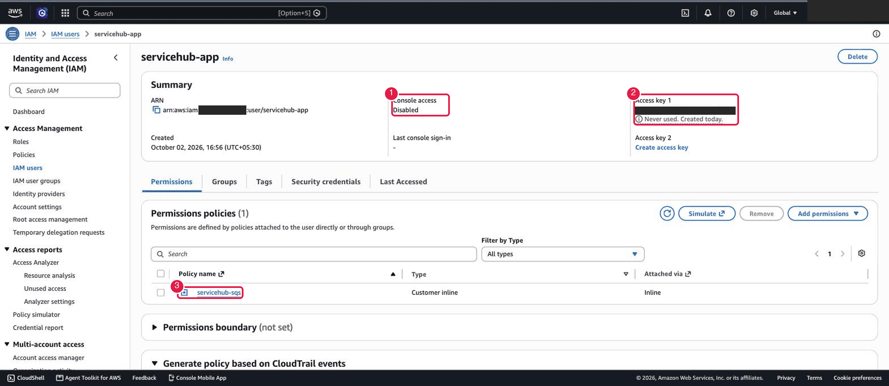


1. Console access — Disabled. This user is for programs only: nobody can sign in to the AWS console as it.
2. Access key 1 — what ServiceHub signs in with. It is made on the Security credentials tab; AWS shows its secret only once.
3. servicehub-sqs — one inline policy, limited to the two queues (next screenshot). The user has no other permissions.


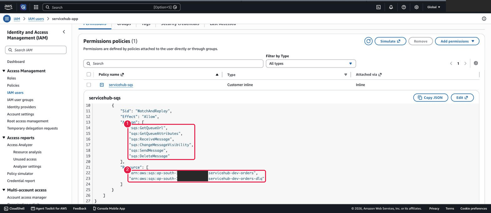


1. Actions — what ServiceHub may do: read queue counts, receive (to look), change visibility (to hand a looked-at message back), send and delete (to replay). Above these, sqs:ListQueues lets it find your queues.
2. Resource — only these two queues. If the key ever leaked, it could touch nothing else in your account.


### 1.5 Create an access key

Open the user's **Security credentials** tab and choose **Create access key**. Pick **Application running outside AWS**, then copy the **Access key ID** and the **Secret access key** — AWS shows the secret **once**. Treat both like a password: ServiceHub encrypts them on arrival and never shows them again. Making the key inactive or deleting it is how you revoke access later.


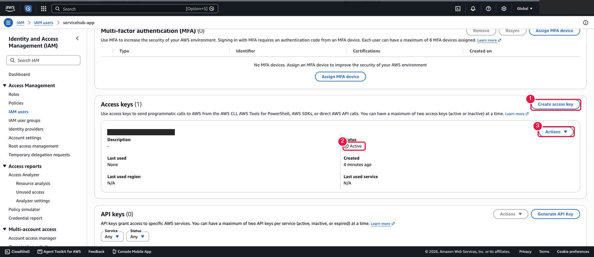


1. Create access key — choose “Application running outside AWS”, then copy the Access key ID and the Secret access key. AWS shows the secret once.
2. Status — Active. Make it Inactive or delete it at any time to cut ServiceHub off.
3. Actions — make the key inactive or delete it: the way to revoke ServiceHub’s access later.


## Part 2 — Connect AWS in ServiceHub

*About two minutes. You only do this once.*


### 2.1 The Connections page

Open **Connections** in the left menu. This is the list of every cloud ServiceHub can read, grouped by cloud. Each row says whether the last test passed, which components are switched on, and has **Test**, **Add a component** and a remove (bin) button. Press **Connect a cloud** to add one.


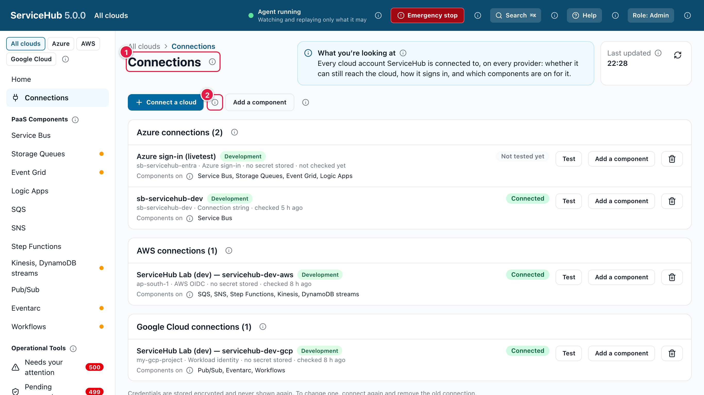


1. Every cloud ServiceHub is connected to. Connecting is how ServiceHub gets read access to your queues and topics.
2. Connect a cloud opens the connect window. Your credentials are encrypted before they are stored and never shown again.


### 2.2 Fill in the connect window

Choose the **AWS SQS / SNS** tab. Give it a name, keep the environment as **Development**, choose **Read and send** (replay needs send), then enter the **Access key ID**, the **Secret access key** and the **Region** of your queues (from Part 1). Nothing is saved until you press **Connect**; ServiceHub then tests the credential, and stores it encrypted (AES-256-GCM). It is never shown again.


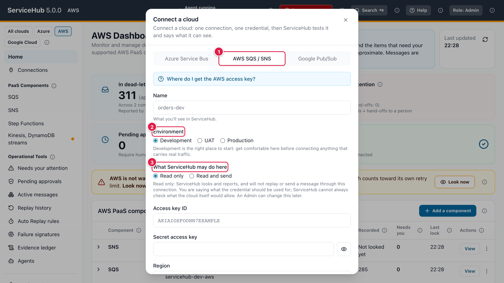


1. Pick the cloud. This guide uses AWS.
2. Say what this connection is: Development, UAT or Production. Start with Development. Production gets the strictest rules.
3. Read only, or Read and send. Read only means ServiceHub can look and can never replay on this connection. Nothing is saved until you press Connect, at the bottom of this window.


### 2.3 Tick the components you want

After connecting, **Add a component** lets you tick other AWS services on the same connection (for example SNS, Step Functions, Kinesis and DynamoDB streams). Each one's access is checked first, read-only, before it is added. Unticking removes it from the menu and keeps every record it produced. A small amber dot beside a component in the menu means it has been built but not yet proven against a real cloud.


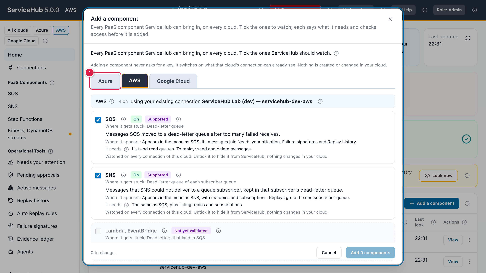


1. Add a component: pick the cloud, then tick each service to list its failed runs or dead-lettered events. Access is checked first, read-only. Unticking keeps every record it produced.


## Part 3 — Learn the screens

*Two minutes of orientation so nothing is a surprise.*


### 3.1 All clouds: Home

The first page. The four tiles say what **needs your attention**, how many replays are **pending approval**, what is dead-lettered, and how many clouds are connected. Below them each cloud has its own card. ServiceHub deliberately shows **no total across clouds**: one cloud counts exactly, one approximately, one not at all, so adding them would give a number that means nothing.


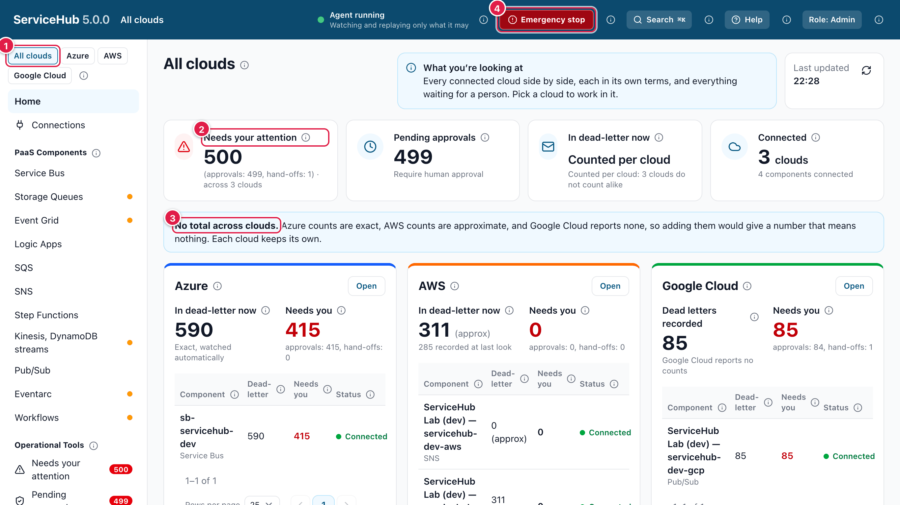


1. The cloud switcher. All clouds shows every connection side by side; Azure, AWS and Google Cloud narrow every page to one cloud. The cloud is also in the address, so a link shows someone exactly what you see.
2. What is waiting for a person across the clouds you connected. It is the number to watch.
3. ServiceHub does not add the clouds together: one counts exactly, one approximately, one not at all, so a sum would mean nothing. Each cloud keeps its own number.
4. Emergency stop. Switches off everything ServiceHub does on its own. It does not touch a replay a person starts.


### 3.2 AWS: Home and the menu

Pick **AWS** in the cloud switcher (top left). The cloud is part of the address, so a link shows someone exactly what you see. The menu has three groups: **PaaS Components** (the AWS services ServiceHub reads), **Operational Tools** (the pages you use every day, the same on every cloud) and **Configuration** with **What ServiceHub covers** at the bottom. The bar on top shows whether the Agent is running, and holds **Emergency stop**, **Search** and **Help**.


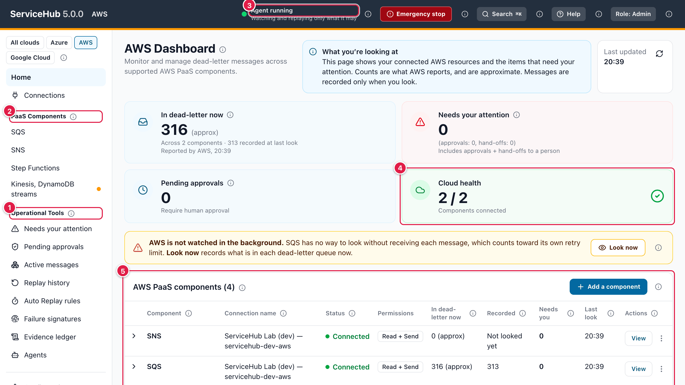


1. Operational Tools: the pages you use every day, the same for every cloud. Start with Needs your attention.
2. The AWS services ServiceHub can read. An amber dot means a component has not been proven against a real cloud yet.
3. The Agent is on. It watches and only replays what it has earned the right to. Hover the (i) beside it to see exactly what it may do.
4. Cloud health: how many of this cloud’s components ServiceHub can reach right now.
5. Every component you connected, whether it is reachable, what ServiceHub may do on it (Read only, or Read + Send), what is dead-lettered and what needs you. View opens it; the three dots hold Deallocate.


## Part 4 — Find and replay a dead-lettered message on AWS

*The core loop: find it, understand it, replay it with a preview, check it held.*


### 4.1 Open the connection

In the menu choose **SQS**, then your connection. The **Overview** says how many messages are dead-lettered now (approximate: SQS counts are what AWS reports, a minute behind), and lists every queue. The tabs are: **Dead-letter messages**, **Recovery** (what was replayed and whether it held), **Access** (what ServiceHub may do here), **Configuration** and **Audit**.


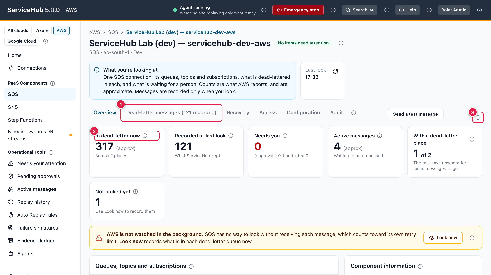


1. The tabs of this connection. Dead-letter messages is where you read and replay; Recovery shows what was replayed and whether it held; Access shows what ServiceHub may do here; Audit is every action.
2. How many messages are dead-lettered right now, and whether the number is exact or approximate on this cloud.
3. Sends one harmless test message to a queue you choose, so you can watch it travel. Optional.


### 4.2 Look now (AWS is not watched in the background)

SQS has no way to look at a message without *receiving* it, and every receive counts as a delivery attempt. So ServiceHub **never looks on its own**. On the **Dead-letter messages** tab a yellow strip says so, and **Look now** records what is in each dead-letter queue right now (up to 100 per queue, handed straight back). Press it once, and wait a few seconds.


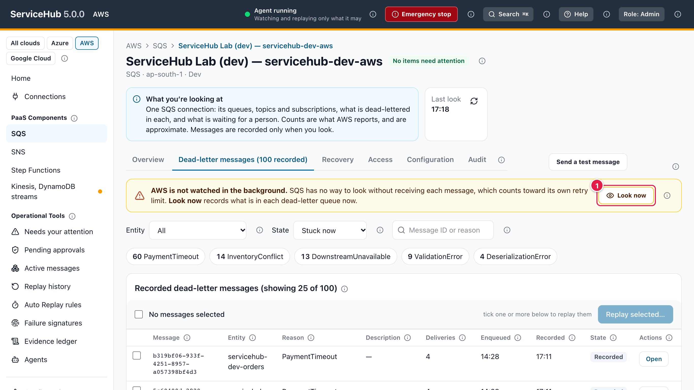


1. AWS is not watched in the background: there is no safe way to count dead letters without a delivery attempt. Look now records what is in the dead-letter queues right now, once, never faster than the cloud allows.


### 4.3 The Dead-letter messages tab

Every dead-lettered message on this connection. Group chips above the table count them by reason. Filter by queue or state, or search by message id or reason (never inside bodies). Tick one or more messages and press **Replay selected…**; a preview opens first. Press **Open** on a row to read one.


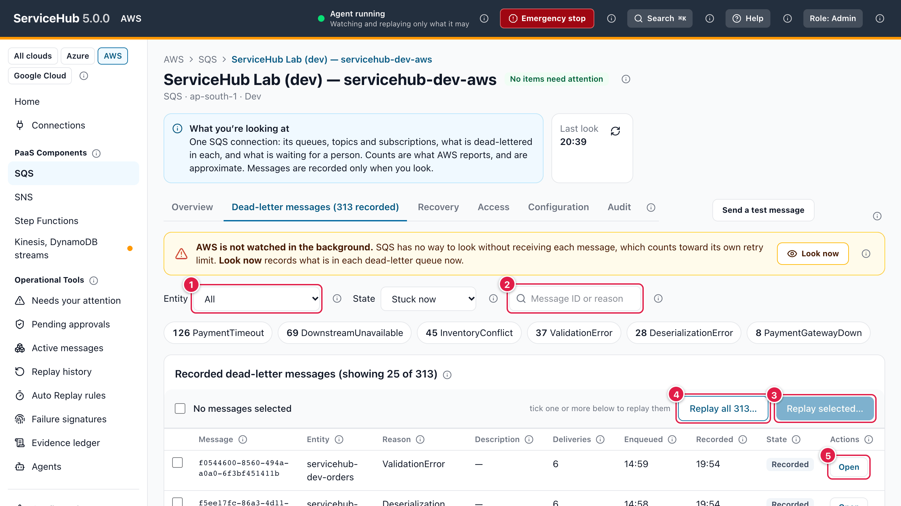


1. Filter by queue, topic or state (Stuck now, No longer stuck, all).
2. Search by message id or by the reason it failed. It never searches inside message bodies.
3. Tick one or more messages, then Replay selected. A preview opens first; nothing is sent until you confirm.
4. Replay all N… opens the preview of every message that matches the filters (at most 500 in one replay, so it says "first 500" when more match). Nothing is sent until you confirm in the preview.
5. Open one message to read why it failed, its body and its history.


### 4.4 Open a message

A side window opens beside the list. **Why it failed** gives the reason, the description, how many times it was tried, and how many others failed the same way. **Body**, **Properties** and **History** are the message exactly as stored. ServiceHub never changes a body. **Replay…** is at the bottom of the window.


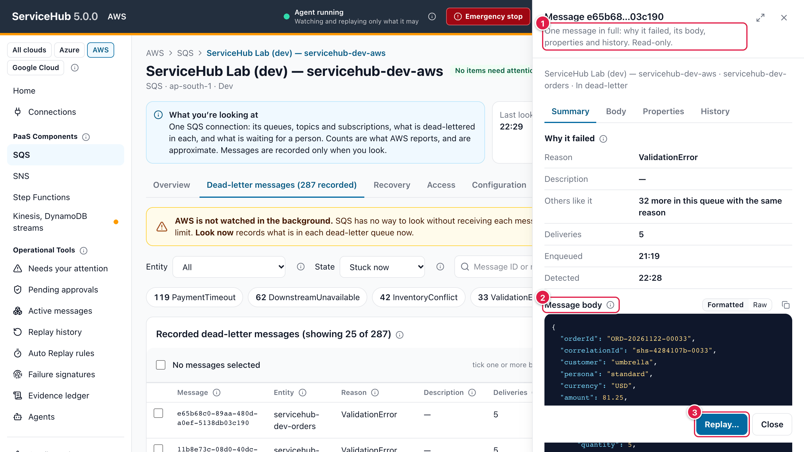


1. The reason and description the cloud recorded, and how many others failed the same way.
2. The message exactly as it was sent. ServiceHub never changes a message body.
3. Replay… opens the preview. It is always a preview first.


### 4.5 The replay preview

Nothing is sent yet. The preview shows the message, where it would go back to, and the safety checks that ran. **Replay 1 message** is the only button that changes anything. Cancel closes it.


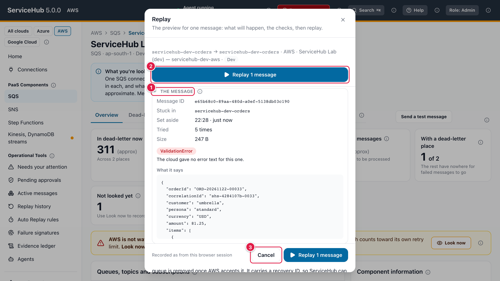


1. The message that would be replayed, exactly as it is stored, and where it would go back to.
2. Replay 1 message sends it back. This is the only button that changes anything, and ServiceHub then watches whether the fix held.
3. Cancel closes the preview. Nothing has been sent.


### 4.6 The result, and whether it held

After **Replay 1 message** the window says **Sent back**, and, on AWS, that the result will read **Verification required**. That is honest: SQS cannot show that the dead-letter queue stayed empty, so ServiceHub cannot call it fixed. In **Replay history** the replay appears as **Unverified**. To get Verified and Came back on AWS, open the connection's **Configuration** tab and switch on **Confirm fixes on this cloud**.


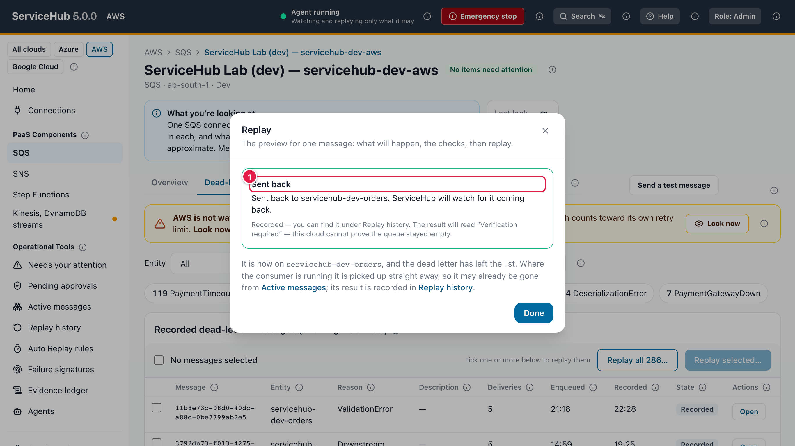


1. The result, in plain words: the message is back on its queue and the dead letter has left the list. Sent back is not the same as fixed. ServiceHub now watches it, and marks it Verified or Came back.


## Part 5 — When ServiceHub asks you

*The Agent never replays what it has not earned. When it is unsure it stops and asks.*


### 5.1 Needs your attention

Everything on this cloud waiting for a person: replays the Agent is holding, and items ServiceHub handed off. The four tiles count them and show the oldest. Filter by component, family or age; **Review** opens the decision.


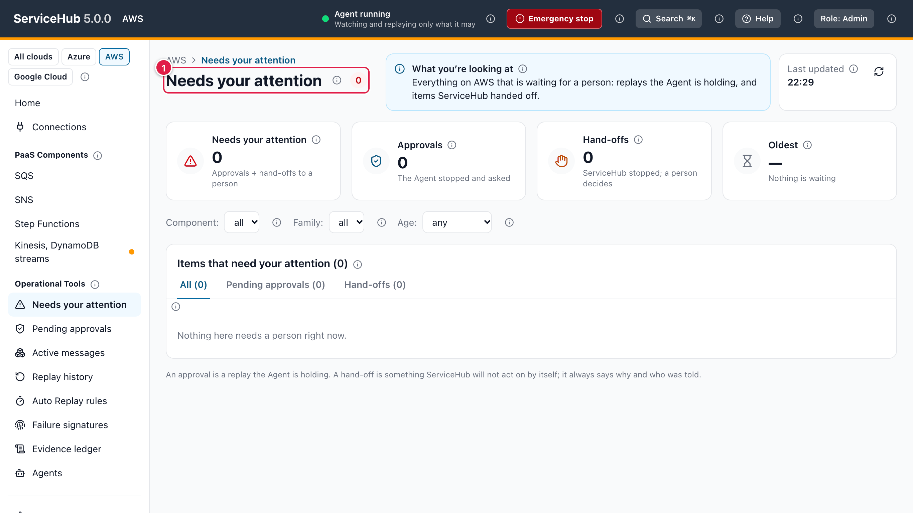


1. Everything on this cloud that waits for a person: replays the Agent is holding, and items ServiceHub handed off. Review opens the decision.


### 5.2 Pending approvals

The held replays on their own. Each row says which failure it was and why the Agent stopped (usually: this kind of failure has not yet earned automatic replay, so a person decides). Approving needs the **Approver** role.


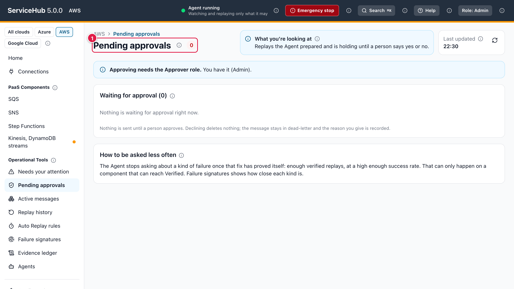


1. Replays the Agent stopped on because this kind of failure has not yet earned automatic replay. You approve or decline each, and the answer is recorded.


### 5.3 Review: approve or decline

Review explains why the Agent stopped, lists the messages that would be replayed, and offers **Approve** or **Decline…**. Declining needs a reason. Both answers are written to the evidence ledger.


## Part 6 — Afterwards

*A replay is not finished when it is sent. ServiceHub watches what happens next.*


### 6.1 Replay history

Every replay, who or what started it, how many messages, and what ServiceHub saw afterwards: **Verified** (did not come back), **Watching** (still inside the window), **Came back** (failed again, so it is not fixed) or **Unverified** (sent, but this cloud cannot prove it held).


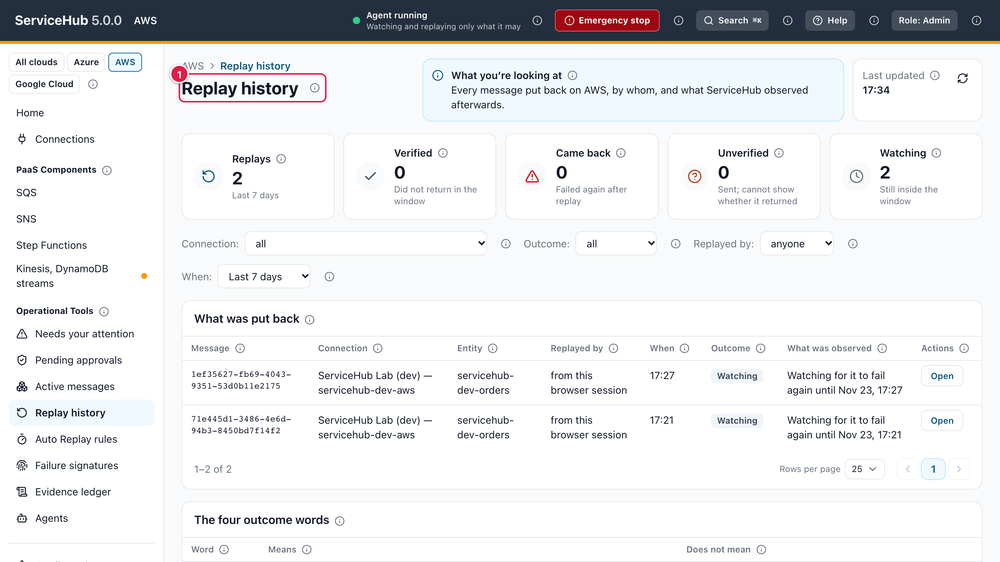


1. Every replay: who or what started it, how many messages, and the outcome ServiceHub saw afterwards (Watching, Verified, Came back, Unverified).


### 6.2 Active messages

The live queues, not the dead-letter ones. Read-only: it exists so you can see whether things are moving. Browse opens a queue's messages without changing them.


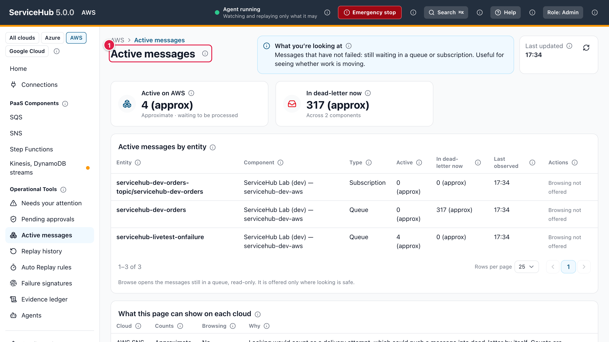


1. Messages in the live queues now, not the dead-letter queues. Read-only.


### 6.3 Failure signatures

Failures grouped by how they fail, so a thousand messages become a handful of causes. For each: how many are stuck, whether replaying has helped before, and how much the Agent may do about it (its level of trust).


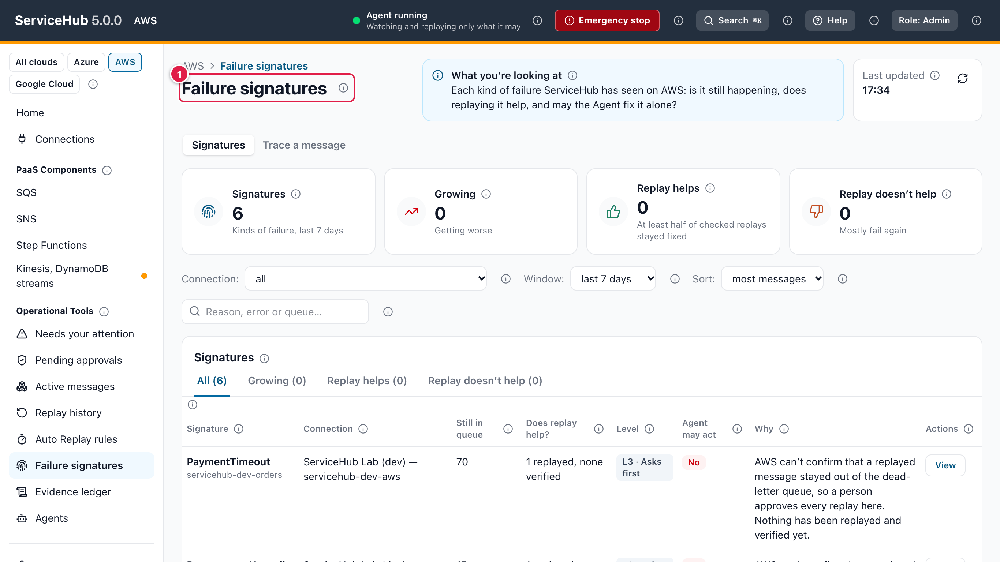


1. Failures grouped by how they fail, so a thousand messages become a handful of causes.


## Part 7 — Letting the Agent help

*Optional, and earned. Nothing is automatic until you create a rule and the failure has a record of verified fixes.*


### 7.1 Auto Replay rules

A rule says: for this failure pattern, replay on your behalf, at this pace. A rule that has not earned trust only produces approvals. If results turn bad it switches itself off and asks a person.


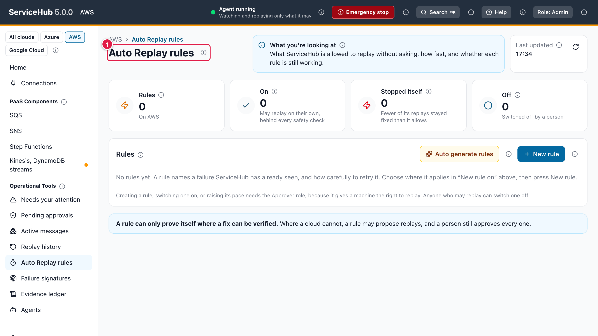


1. What the Agent may replay by itself. A rule is on only for a failure pattern that has earned it; it stops and asks a person when results turn bad.


### 7.2 Agents

The background workers: what each one does, whether it is healthy, when it last ran, and whether it may act or only observe. Pause any of them from here.


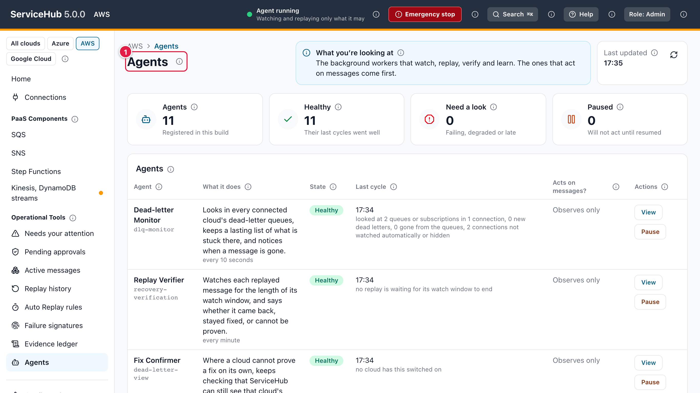


1. The background workers: what each does, when it last ran and whether it is healthy.


### 7.3 Evidence ledger

A tamper-evident record of every decision ServiceHub took, with who or what took it. Each entry is chained to the one before; export it and check it offline with `scripts/verify-recovery-chain.py`.


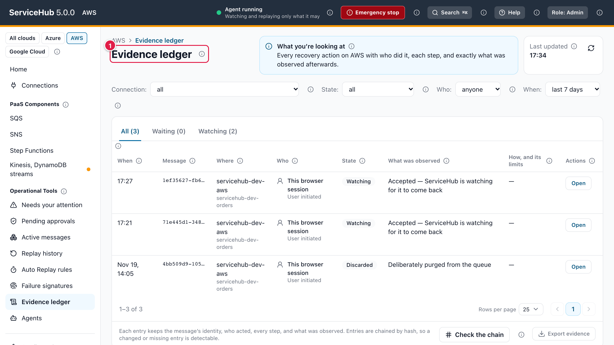


1. The tamper-evident record of every decision. Export it and check it offline with verify-recovery-chain.py.


## Part 8 — Configuration, Help and safety

*Where the rest lives.*


### 8.1 Configuration

How ServiceHub looks (**Preferences**), who may do what (**Access**), **Notifications**, **Backup** and restore, and the list of **Connections** again, with each cloud's own settings.


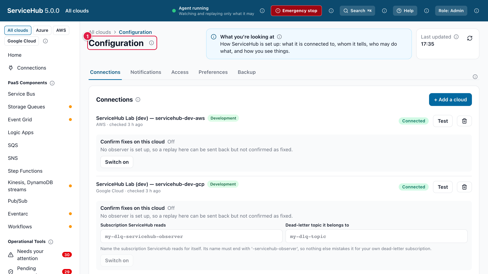


1. Configuration: how ServiceHub looks, who may do what, backup and restore, and notifications.


### 8.2 Help and Search

**Help** (or press `?`) has answers by task, the step-by-step guides, and the keyboard shortcuts. **Search** (Cmd-K or Ctrl-K) finds a connection, a queue, a page or an action; it never searches inside messages.


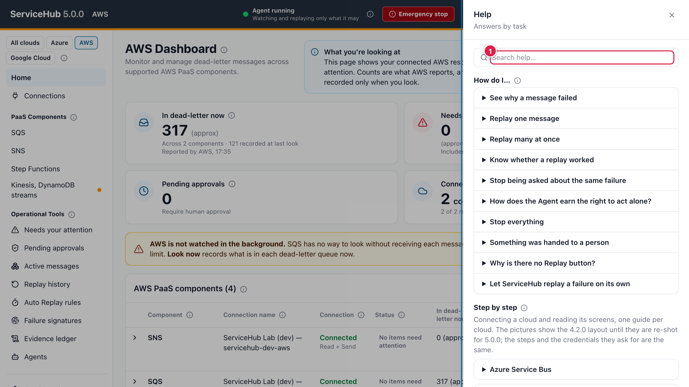


1. Search the Help. Below it: short answers by task, then the step-by-step guide for each cloud. Press ? from any page to open Help.


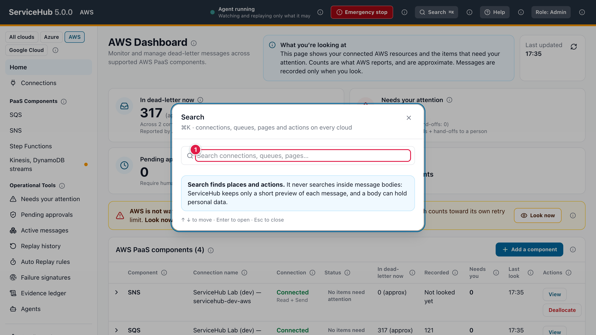


1. Search finds a connection, a queue, a page or an action from anywhere (Cmd-K or Ctrl-K). It never searches inside messages.


### 8.3 Emergency stop

Switches off everything ServiceHub does on its own. It asks for a reason and for you to type STOP. A replay a person starts still works, and anything already sent stays sent.


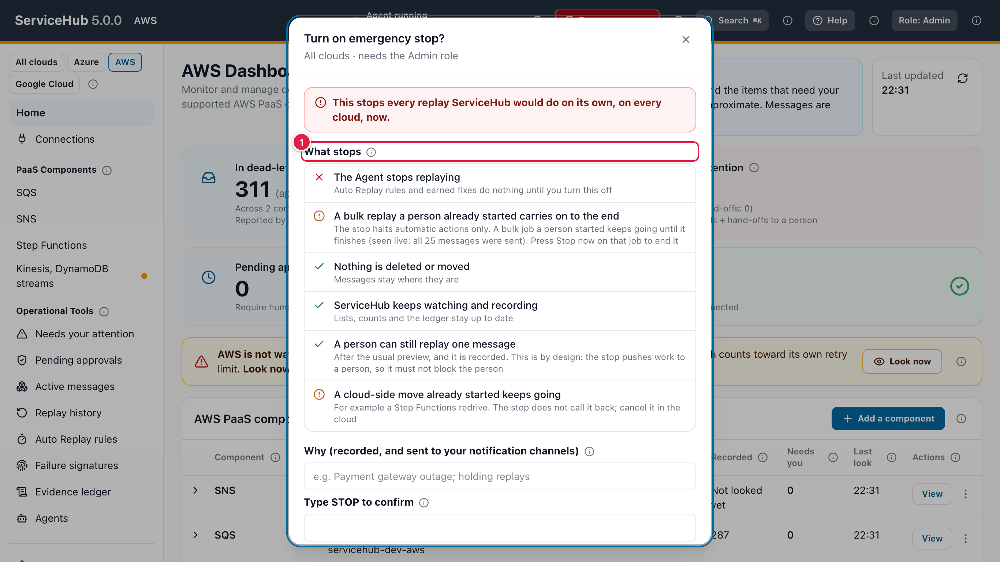


1. Exactly what stops (the Agent, automatic replays) and what does not (a replay a person starts, what is already recorded). Below: a reason, and you type STOP to confirm.


### 8.4 What ServiceHub covers

Every component on every cloud, and how far each has been proven: **Supported** (seen working against a real cloud) or **Being validated** (built, not yet proven).


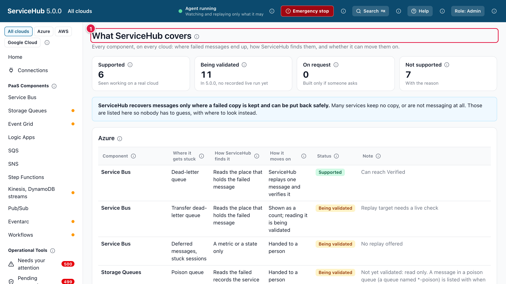


1. What ServiceHub covers: every component, per cloud, and how far each has been proven (Supported, or Being validated).


---

## If something goes wrong

- **Connect says the key is invalid or the signature does not match.** Check the Access key ID and Secret access key were copied whole, with no spaces, and that the key is **Active** (IAM → the user → Security credentials). A secret cannot be shown again: if you lost it, create a new key.
- **Connect works but finds 0 queues.** Check the **region** — queues in another region are not seen — and that the policy includes `sqs:ListQueues` with Resource `*`.
- **Dead letters stays empty after Look now.** The dead-letter queue may really be empty, or the policy lacks `sqs:ReceiveMessage` on the dead-letter queue's ARN. Make sure both queue ARNs are in the policy's Resource list.
- **Replay is unavailable or refused.** The policy lacks `sqs:SendMessage` (to put the copy back) or `sqs:DeleteMessage` (to remove the dead-letter copy), or the main queue's ARN is missing from Resource.
- **A looked-at message seems stuck for a while.** The policy lacks `sqs:ChangeMessageVisibility`, so ServiceHub cannot hand a message back at once; SQS releases it after its visibility timeout (30 seconds by default). Add the action.
- **The count is not exactly what the console shows.** SQS counts are approximate and can lag a minute. Look now records up to 100 per queue, so the Dead letters tab can show fewer than the queue holds.
- **Why does every replay say “Verification required”?.** ServiceHub can prove a fix held only where the cloud can show the dead-letter queue stayed empty. AWS cannot, so ServiceHub records the replay honestly instead of calling it fixed.


## Stopping and cleaning up

To stop ServiceHub watching AWS: **Connections**, the bin button on the connection, then typing its name to confirm. That forgets the connection and its stored credential on the ServiceHub server;
it deletes nothing in AWS. To revoke access in AWS, make the access key **Inactive** or delete it (IAM → the user → Security credentials), and delete the user
if you no longer need it. If you created the queues only to try ServiceHub, delete them in SQS so nothing keeps costing money.
