# ServiceHub on Azure Service Bus — step by step, with real screenshots

> **Prefer to watch?** A captioned walkthrough of every screen, about six minutes: [Azure Service Bus full video](../media/azure-full.mp4). Short on time? The pain and what ServiceHub gives you, in about two minutes: [short video](../media/azure-short.mp4).

This guide takes you from nothing to a working ServiceHub on **Azure Service Bus**, one screen at a time. Every picture is the real
application (or the real Azure portal) — not a mock-up — with numbered markers; the numbered list under each picture says what that control
does **and what it will not do**.

**What you will do**

1. In the Azure portal, make a policy just for ServiceHub, and copy its connection string.
2. Connect Azure in ServiceHub and check it can see your queues.
3. Find a dead-lettered message, understand why it failed, and replay it safely.
4. See that the replay held, and learn what Auto Replay, the Evidence ledger and Configuration show.

**What you need**

| You need | Why |
|---|---|
| An Azure Service Bus namespace (Standard or Premium for topics; queues work on every tier) | ServiceHub reads what is in it |
| Permission in Azure to create a *Shared access policy* on that namespace | You will make a ServiceHub-only credential |
| **Local Authentication: Enabled** on the namespace | ServiceHub connects with a connection string (shared access key). If your organisation disables it, use a namespace where it is on |
| ServiceHub running (see the README) | You will open it in a browser |

> **Cost.** Looking at Azure from ServiceHub is free of delivery side-effects: on Azure a *peek* is not a delivery, so reading a queue never
> consumes a message or adds a delivery attempt. Your normal Service Bus charges apply; ServiceHub adds none of its own.

---

## Part 1 — In the Azure portal

*Do these first. Each step shows the real portal.*

### 1.1 Open your Service Bus namespace

Sign in to the Azure portal, search for **Service Bus** and open your namespace. Note the **Host name** (it ends in `.servicebus.windows.net`) and that **Local Authentication** is *Enabled*. In the left menu, **Settings → Shared access policies** is where the next step happens.

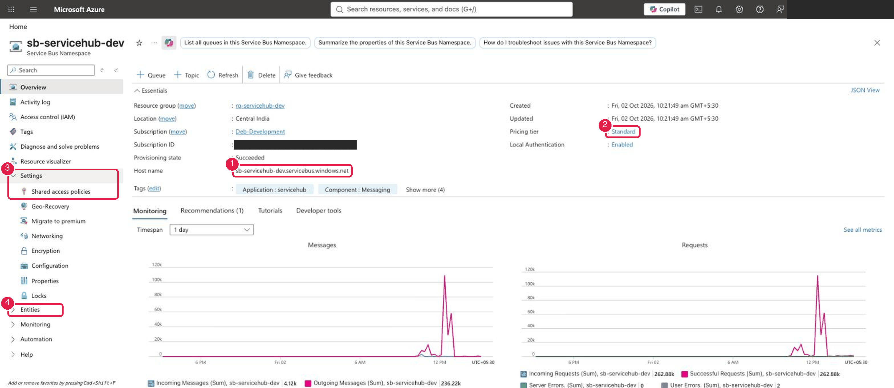

1. Host name — the address of your namespace. Your connection string begins Endpoint=sb:// followed by this name.
2. Pricing tier — Standard or Premium. Basic has no topics; queues work on every tier.
3. Settings → Shared access policies — where you create and copy the connection string ServiceHub uses.
4. Entities — your Queues and Topics live here.

### 1.2 Shared access policies — and why not to reuse the default

Every namespace has `RootManageSharedAccessKey`, a default key shared by everything that touches the namespace. Give ServiceHub its **own** policy instead, so you can revoke it later without disturbing anything else.

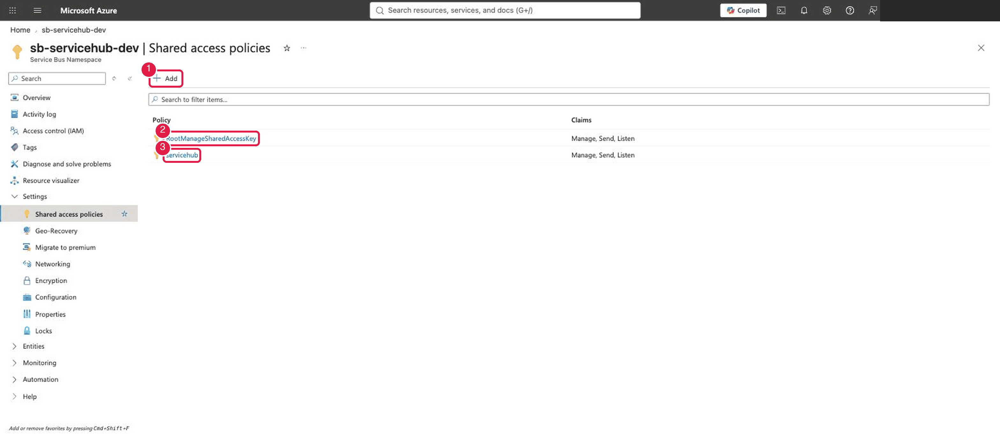

1. Add — creates a new policy. Make one just for ServiceHub, so you can revoke it without touching anything else.
2. RootManageSharedAccessKey — the namespace's default key, shared by everything. Do not hand this one to ServiceHub.
3. Any policy you already have for another tool — better not to share it. Give ServiceHub its own.

### 1.3 Create a ServiceHub-only policy

Choose **Add**, name it (we use `servicehub-app`), tick **Manage** — Azure then ticks **Send** and **Listen** for you — and **Create**. Why Manage? Azure only lets a *Manage* policy **list** your queues and **count** their messages; with Listen and Send alone ServiceHub cannot even see which queues exist (Azure answers *401: Manage, EntityRead claims required*). ServiceHub uses *Send* only when you press Replay.

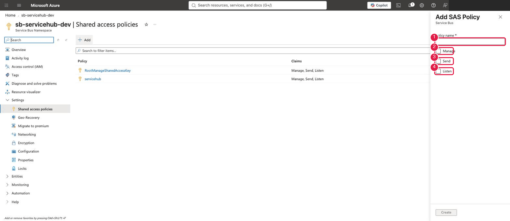

1. Policy name — for example servicehub-app, so you can recognise (and later revoke) it.
2. Manage — required. Azure lets only Manage list your queues and count their messages; without it ServiceHub cannot see them.
3. Send — used only when you press Replay, to put a copy of a dead letter back.
4. Listen — used to read queues and dead-letter queues.

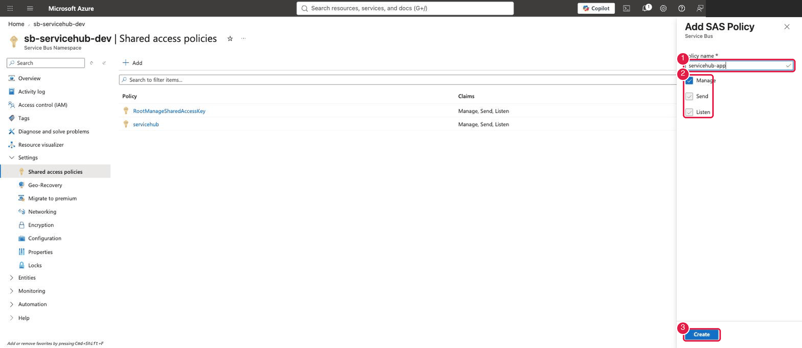

1. The name you chose.
2. Manage, Send and Listen. Azure ticks Send and Listen for you when you tick Manage — Manage includes them.
3. Create — saves the policy and generates its keys.

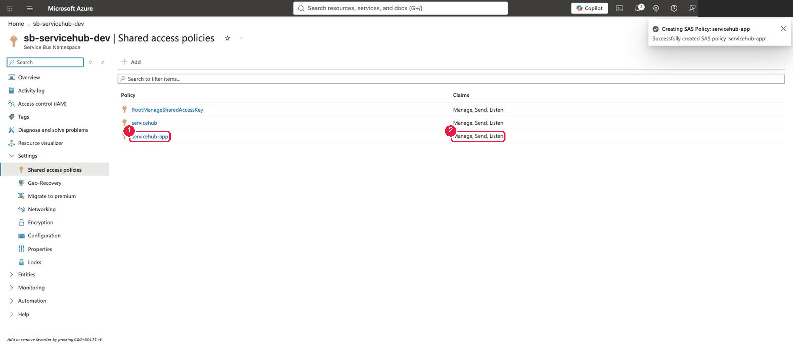

1. Your new policy appears in the list.
2. Claims — Manage, Send, Listen.

### 1.4 Copy the primary connection string

Open the new policy. The keys are hidden; click the copy icon beside **Primary connection string**. It begins `Endpoint=sb://…`. Treat it like a password: ServiceHub encrypts it on arrival and never shows it again, but anyone who has it can use it. The **Delete** button on this panel is how you revoke access later.

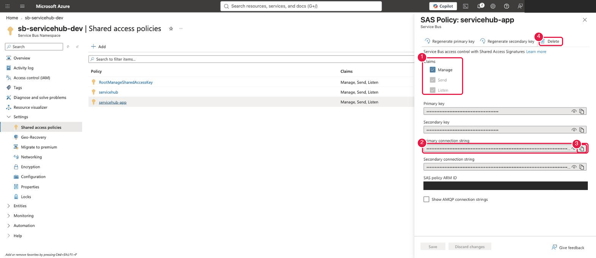

1. Claims — what this policy may do.
2. Primary connection string — click the eye to reveal, then the copy icon. Paste this into ServiceHub. Treat it like a password.
3. Copy to clipboard — copies the whole connection string.
4. Delete — the way to revoke ServiceHub's access later.

### 1.5 Check what is in your queues

Under **Entities → Queues** you can see each queue's *Active* and *Dead-letter* counts. Open a queue to see its **Max delivery count** (after that many failed tries Azure dead-letters the message) — ServiceHub's numbers should match these.

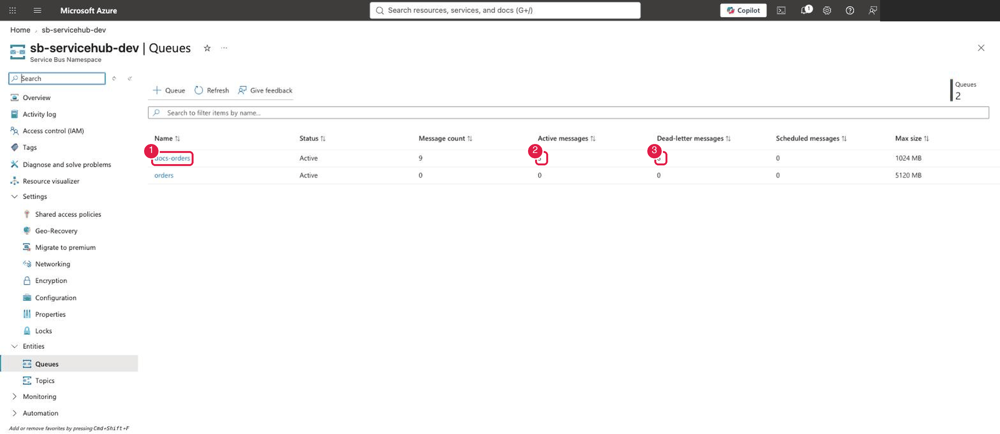

1. Queue name — ServiceHub finds every queue in the namespace; you do not list them.
2. Active messages — waiting to be processed.
3. Dead-letter messages — failed too often and were set aside. These are what ServiceHub shows on its Dead letters tab.

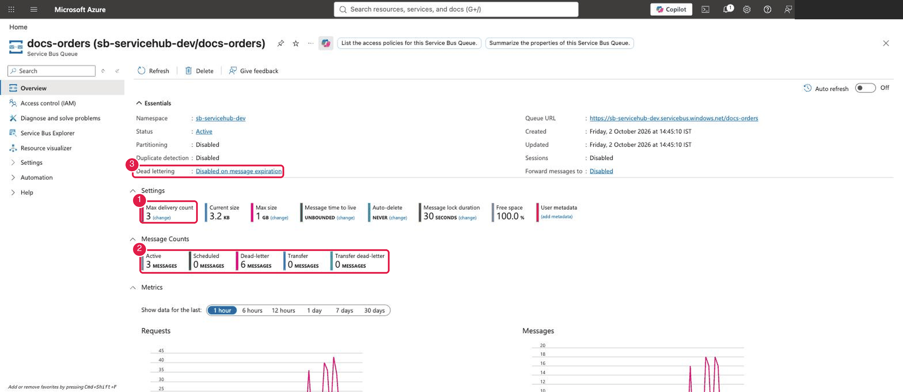

1. Max delivery count — how many tries before Azure dead-letters a message. Here 3.
2. Message counts — Active and Dead-letter must match what ServiceHub shows.
3. Dead lettering on expiry is off — messages here are dead-lettered by delivery count or by your app, which is all ServiceHub needs.

## Part 2 — Connect Azure in ServiceHub

*About two minutes. You only do this once.*

### 2.1 The Connections page

Open **Connections** in the left menu. This is the list of every cloud ServiceHub can read, grouped by cloud. Each row says whether the last test passed, which components are switched on, and has **Test**, **Add a component** and a remove (bin) button. Press **Connect a cloud** to add one.

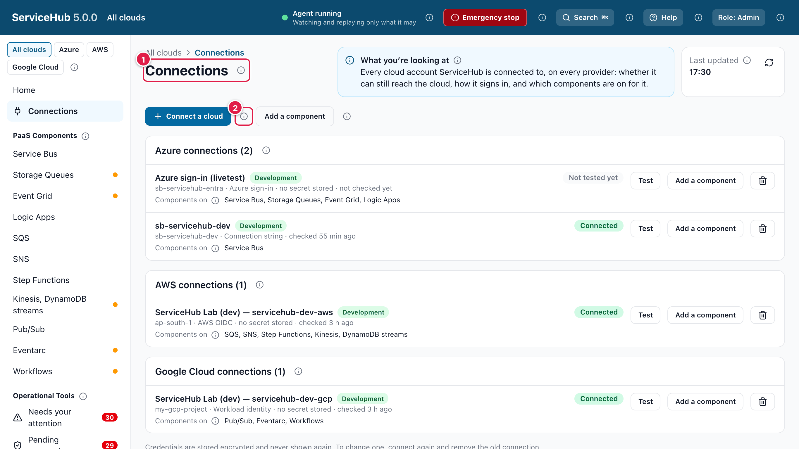

1. Every cloud ServiceHub is connected to. Connecting is how ServiceHub gets read access to your queues and topics.
2. Connect a cloud opens the connect window. Your credentials are encrypted before they are stored and never shown again.

### 2.2 Fill in the connect window

Choose the **Azure Service Bus** tab. Give it a name, keep the environment as **Development** for a first connection, choose **Read and send** (replay needs send; **Read only** looks but never replays), and paste the connection string from step 1.4. Nothing is saved until you press **Connect**; ServiceHub then tests the credential, and stores it encrypted (AES-256-GCM). It is never shown again.

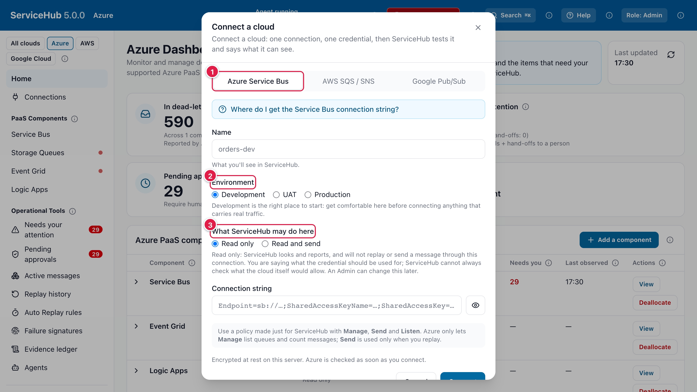

1. Pick the cloud. This guide uses Azure.
2. Say what this connection is: Development, UAT or Production. Start with Development. Production gets the strictest rules.
3. Read only, or Read and send. Read only means ServiceHub can look and can never replay on this connection. Nothing is saved until you press Connect, at the bottom of this window.

### 2.3 Tick the components you want

After connecting, **Add a component** lets you tick other Azure services on the same connection (for example Logic Apps and Event Grid; these sign in with Microsoft Entra rather than a connection string, so they need an Entra connection). Each one's access is checked first, read-only, before it is added. Unticking removes it from the menu and keeps every record it produced. A small amber dot beside a component in the menu means it has been built but not yet proven against a real cloud.

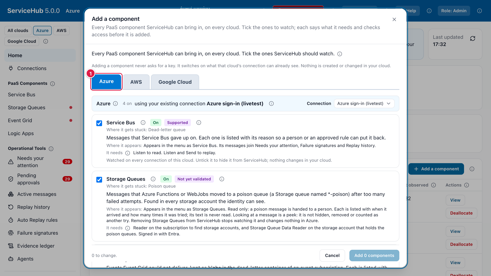

1. Add a component: pick the cloud, then tick each service to list its failed runs or dead-lettered events. Access is checked first, read-only. Unticking keeps every record it produced.

## Part 3 — Learn the screens

*Two minutes of orientation so nothing is a surprise.*

### 3.1 All clouds: Home

The first page. The four tiles say what **needs your attention**, how many replays are **pending approval**, what is dead-lettered, and how many clouds are connected. Below them each cloud has its own card. ServiceHub deliberately shows **no total across clouds**: one cloud counts exactly, one approximately, one not at all, so adding them would give a number that means nothing.

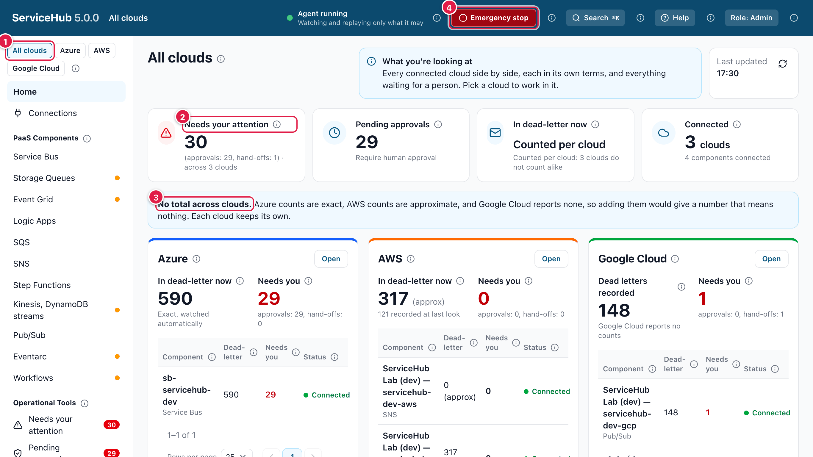

1. The cloud switcher. All clouds shows every connection side by side; Azure, AWS and Google Cloud narrow every page to one cloud. The cloud is also in the address, so a link shows someone exactly what you see.
2. What is waiting for a person across the clouds you connected. It is the number to watch.
3. ServiceHub does not add the clouds together: one counts exactly, one approximately, one not at all, so a sum would mean nothing. Each cloud keeps its own number.
4. Emergency stop. Switches off everything ServiceHub does on its own. It does not touch a replay a person starts.

### 3.2 Azure: Home and the menu

Pick **Azure** in the cloud switcher (top left). The cloud is part of the address, so a link shows someone exactly what you see. The menu has three groups: **PaaS Components** (the Azure services ServiceHub reads), **Operational Tools** (the pages you use every day, the same on every cloud) and **Configuration** with **What ServiceHub covers** at the bottom. The bar on top shows whether the Agent is running, and holds **Emergency stop**, **Search** and **Help**.

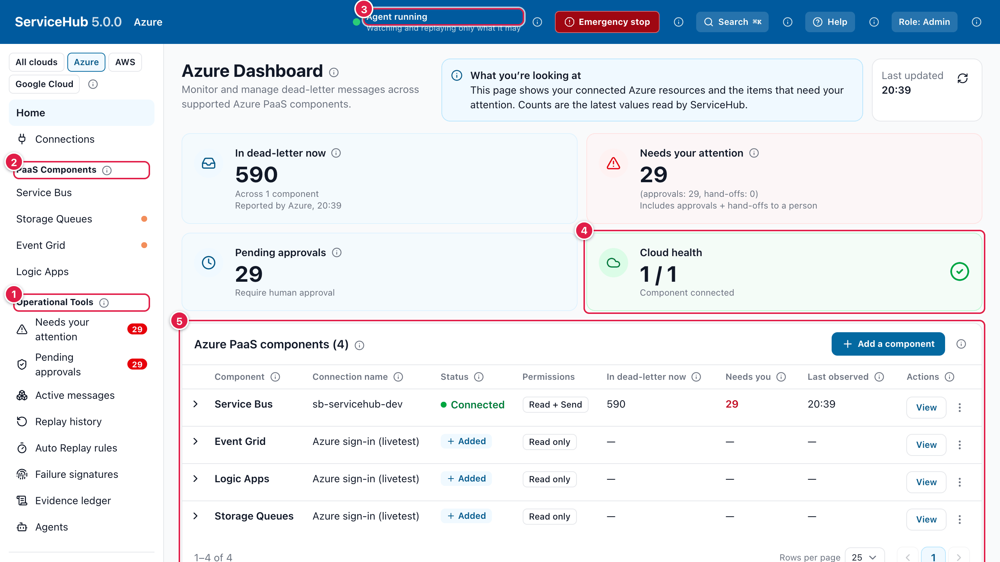

1. Operational Tools: the pages you use every day, the same for every cloud. Start with Needs your attention.
2. The Azure services ServiceHub can read. An amber dot means a component has not been proven against a real cloud yet.
3. The Agent is on. It watches and only replays what it has earned the right to. Hover the (i) beside it to see exactly what it may do.
4. Cloud health: how many of this cloud’s components ServiceHub can reach right now.
5. Every component you connected, whether it is reachable, what ServiceHub may do on it (Read only, or Read + Send), what is dead-lettered and what needs you. View opens it; the three dots hold Deallocate.

## Part 4 — Find and replay a dead-lettered message on Azure

*The core loop: find it, understand it, replay it with a preview, check it held.*

### 4.1 Open the connection

In the menu choose **Service Bus**, then your connection. The **Overview** says how many messages are dead-lettered now (exact, because Azure reports exact counts and ServiceHub watches the namespace automatically), and lists every queue, topic and subscription. The tabs are: **Dead-letter messages**, **Recovery** (what was replayed and whether it held), **Access** (what ServiceHub may do here), **Configuration** and **Audit**.

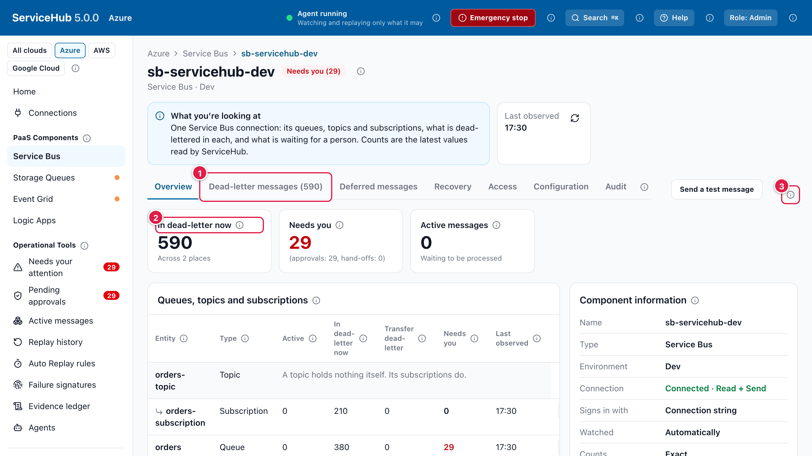

1. The tabs of this connection. Dead-letter messages is where you read and replay; Recovery shows what was replayed and whether it held; Access shows what ServiceHub may do here; Audit is every action.
2. How many messages are dead-lettered right now, and whether the number is exact or approximate on this cloud.
3. Sends one harmless test message to a queue you choose, so you can watch it travel. Optional.

### 4.2 The Dead-letter messages tab

Every dead-lettered message on this connection. Group chips above the table count them by reason. Filter by queue or state, or search by message id or reason (never inside bodies). Tick one or more messages and press **Replay selected…**; a preview opens first. Press **Open** on a row to read one.

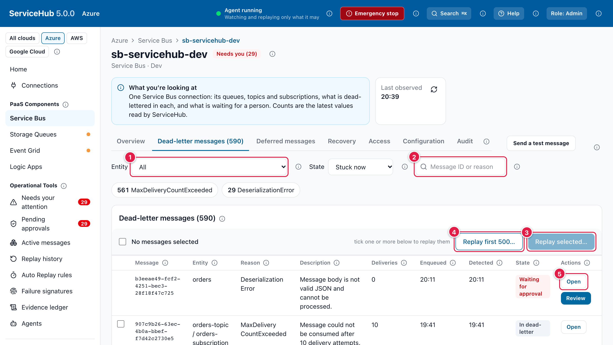

1. Filter by queue, topic or state (Stuck now, No longer stuck, all).
2. Search by message id or by the reason it failed. It never searches inside message bodies.
3. Tick one or more messages, then Replay selected. A preview opens first; nothing is sent until you confirm.
4. Replay all N… opens the preview of every message that matches the filters (at most 500 in one replay, so it says "first 500" when more match). Nothing is sent until you confirm in the preview.
5. Open one message to read why it failed, its body and its history.

### 4.3 Open a message

A side window opens beside the list. **Why it failed** gives the reason, the description, how many times it was tried, and how many others failed the same way. **Body**, **Properties** and **History** are the message exactly as stored. ServiceHub never changes a body. **Replay…** is at the bottom of the window.

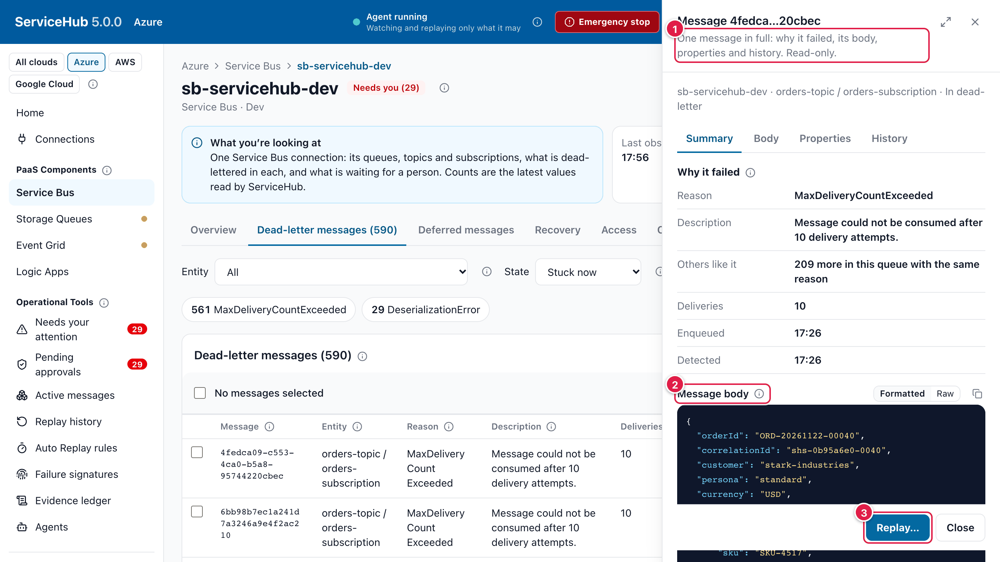

1. The reason and description the cloud recorded, and how many others failed the same way.
2. The message exactly as it was sent. ServiceHub never changes a message body.
3. Replay… opens the preview. It is always a preview first.

### 4.4 The replay preview

Nothing is sent yet. The preview shows the message, where it would go back to, and the safety checks that ran. **Replay 1 message** is the only button that changes anything. Cancel closes it.

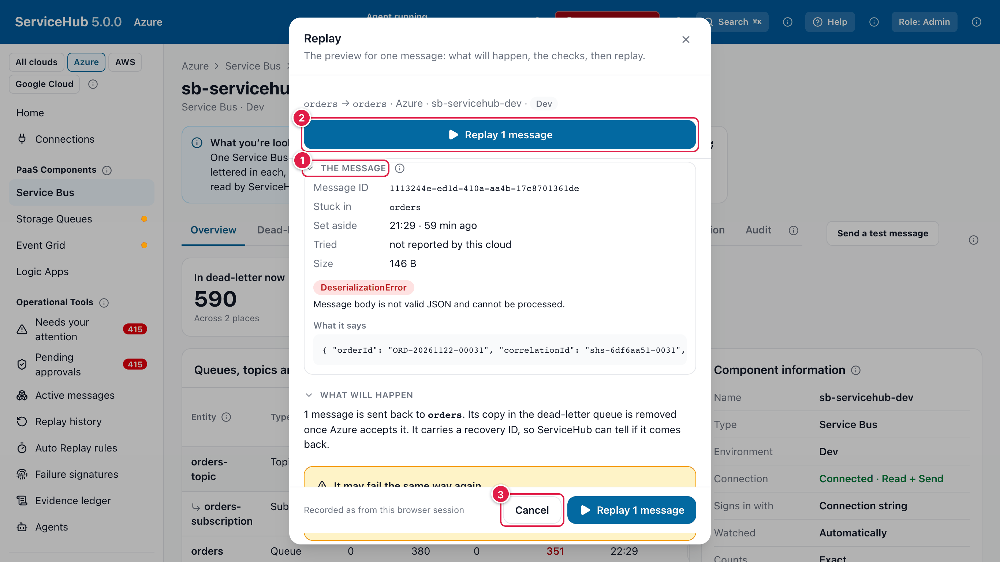

1. The message that would be replayed, exactly as it is stored, and where it would go back to.
2. Replay 1 message sends it back. This is the only button that changes anything, and ServiceHub then watches whether the fix held.
3. Cancel closes the preview. Nothing has been sent.

### 4.5 The result, and whether it held

After **Replay 1 message** the window says **Sent back**: the message is on its queue again and the dead letter has left the list. Where a consumer is running it is picked up at once, so it may already be gone from **Active messages**. On Azure ServiceHub can prove the outcome: it watches the dead-letter queue for the observation window and then marks the replay **Verified** (it did not come back) or **Came back** (it failed again, so it is not fixed). Find it in **Replay history**.

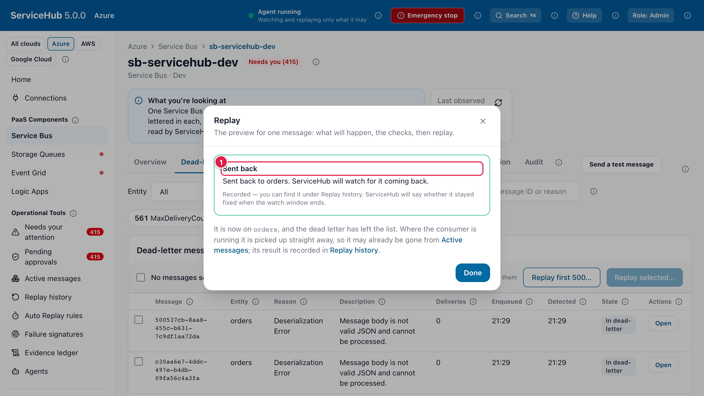

1. The result, in plain words: the message is back on its queue and the dead letter has left the list. Sent back is not the same as fixed. ServiceHub now watches it, and marks it Verified or Came back.

## Part 5 — When ServiceHub asks you

*The Agent never replays what it has not earned. When it is unsure it stops and asks.*

### 5.1 Needs your attention

Everything on this cloud waiting for a person: replays the Agent is holding, and items ServiceHub handed off. The four tiles count them and show the oldest. Filter by component, family or age; **Review** opens the decision.

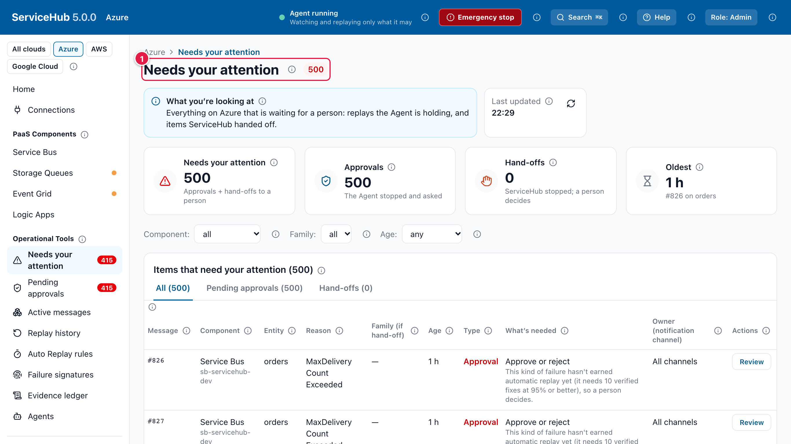

1. Everything on this cloud that waits for a person: replays the Agent is holding, and items ServiceHub handed off. Review opens the decision.

### 5.2 Pending approvals

The held replays on their own. Each row says which failure it was and why the Agent stopped (usually: this kind of failure has not yet earned automatic replay, so a person decides). Approving needs the **Approver** role.

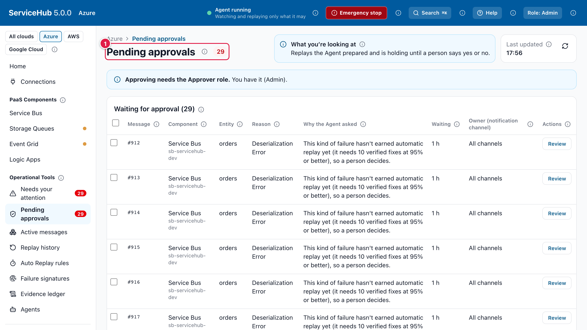

1. Replays the Agent stopped on because this kind of failure has not yet earned automatic replay. You approve or decline each, and the answer is recorded.

### 5.3 Review: approve or decline

Review explains why the Agent stopped, lists the messages that would be replayed, and offers **Approve** or **Decline…**. Declining needs a reason. Both answers are written to the evidence ledger.

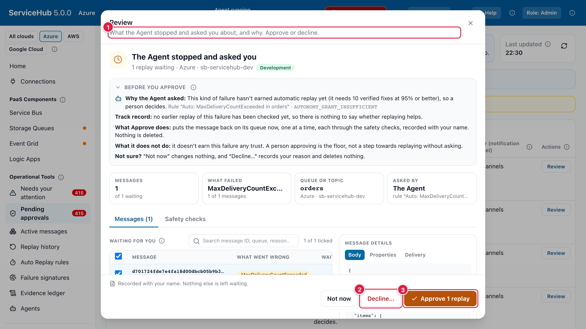

1. Why the Agent stopped: this kind of failure has not yet earned automatic replay, so a person decides.
2. Decline needs a reason. Nothing is sent, and the reason goes in the ledger.
3. Approve replays the messages listed here, once, through the same safety gate as a manual replay.

## Part 6 — Afterwards

*A replay is not finished when it is sent. ServiceHub watches what happens next.*

### 6.1 Replay history

Every replay, who or what started it, how many messages, and what ServiceHub saw afterwards: **Verified** (did not come back), **Watching** (still inside the window), **Came back** (failed again, so it is not fixed) or **Unverified** (sent, but this cloud cannot prove it held).

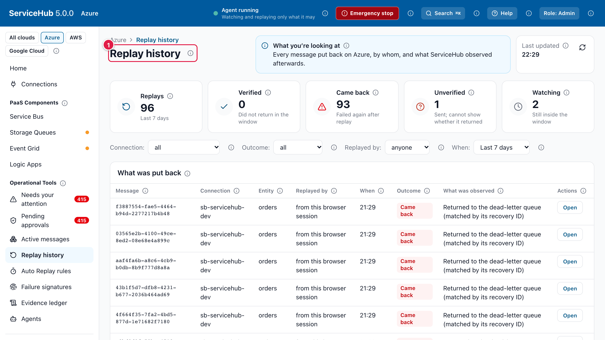

1. Every replay: who or what started it, how many messages, and the outcome ServiceHub saw afterwards (Watching, Verified, Came back, Unverified).

### 6.2 Active messages

The live queues, not the dead-letter ones. Read-only: it exists so you can see whether things are moving. Browse opens a queue's messages without changing them.

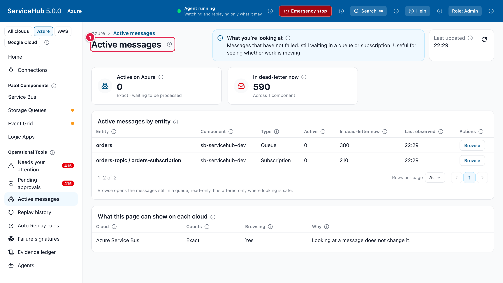

1. Messages in the live queues now, not the dead-letter queues. Read-only.

### 6.3 Failure signatures

Failures grouped by how they fail, so a thousand messages become a handful of causes. For each: how many are stuck, whether replaying has helped before, and how much the Agent may do about it (its level of trust).

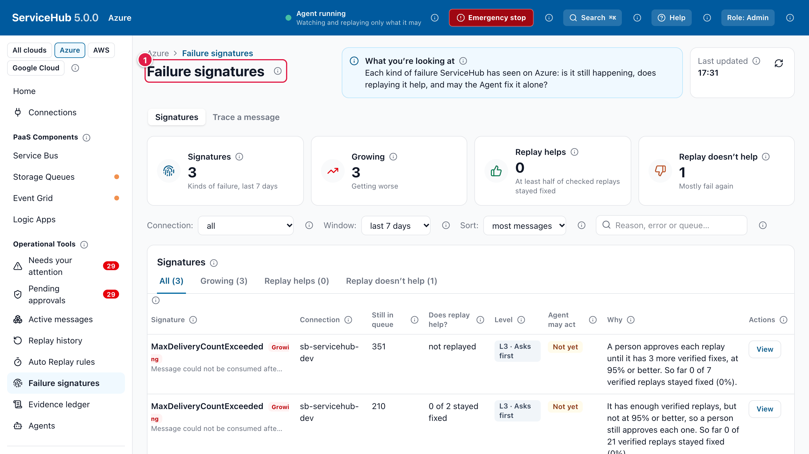

1. Failures grouped by how they fail, so a thousand messages become a handful of causes.

## Part 7 — Letting the Agent help

*Optional, and earned. Nothing is automatic until you create a rule and the failure has a record of verified fixes.*

### 7.1 Auto Replay rules

A rule says: for this failure pattern, replay on your behalf, at this pace. A rule that has not earned trust only produces approvals. If results turn bad it switches itself off and asks a person.

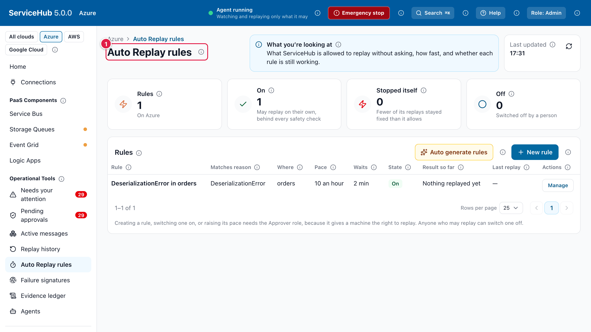

1. What the Agent may replay by itself. A rule is on only for a failure pattern that has earned it; it stops and asks a person when results turn bad.

### 7.2 Agents

The background workers: what each one does, whether it is healthy, when it last ran, and whether it may act or only observe. Pause any of them from here.

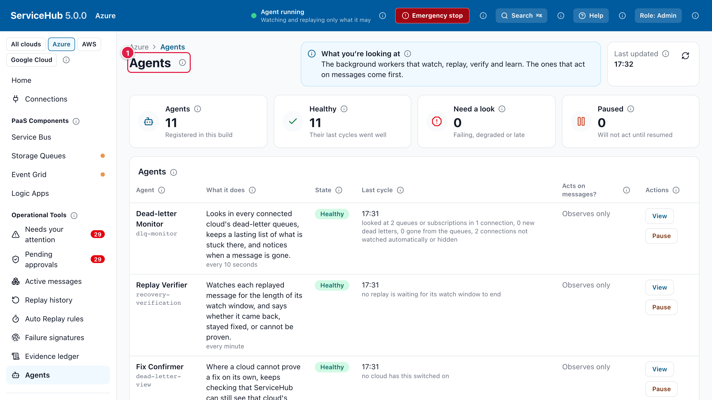

1. The background workers: what each does, when it last ran and whether it is healthy.

### 7.3 Evidence ledger

A tamper-evident record of every decision ServiceHub took, with who or what took it. Each entry is chained to the one before; export it and check it offline with `scripts/verify-recovery-chain.py`.

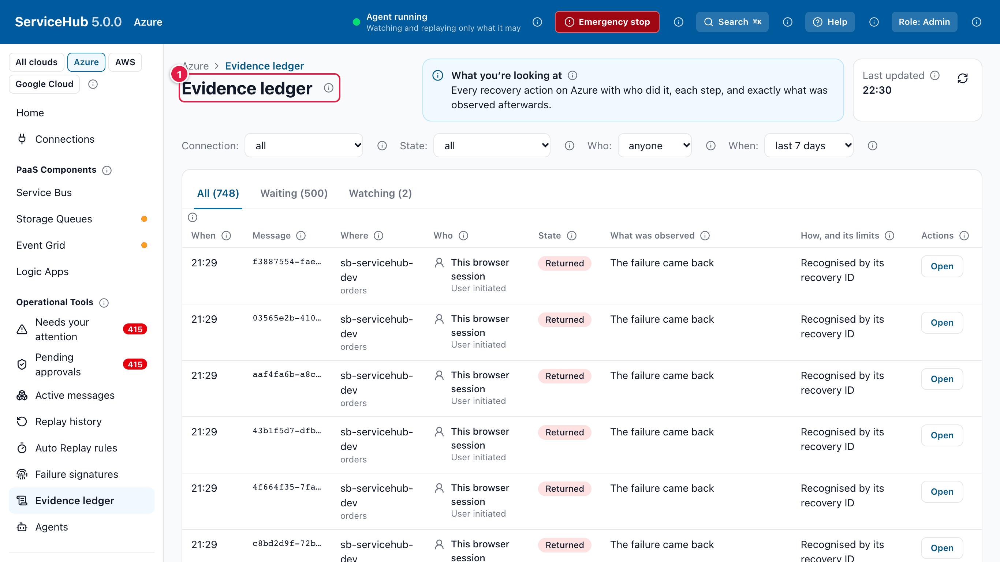

1. The tamper-evident record of every decision. Export it and check it offline with verify-recovery-chain.py.

## Part 8 — Configuration, Help and safety

*Where the rest lives.*

### 8.1 Configuration

How ServiceHub looks (**Preferences**), who may do what (**Access**), **Notifications**, **Backup** and restore, and the list of **Connections** again, with each cloud's own settings.

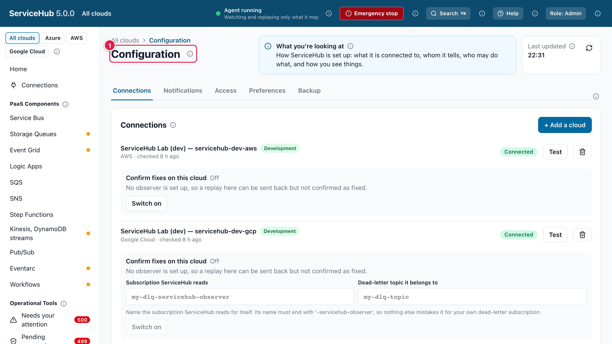

1. Configuration: how ServiceHub looks, who may do what, backup and restore, and notifications.

### 8.2 Help and Search

**Help** (or press `?`) has answers by task, the step-by-step guides, and the keyboard shortcuts. **Search** (Cmd-K or Ctrl-K) finds a connection, a queue, a page or an action; it never searches inside messages.

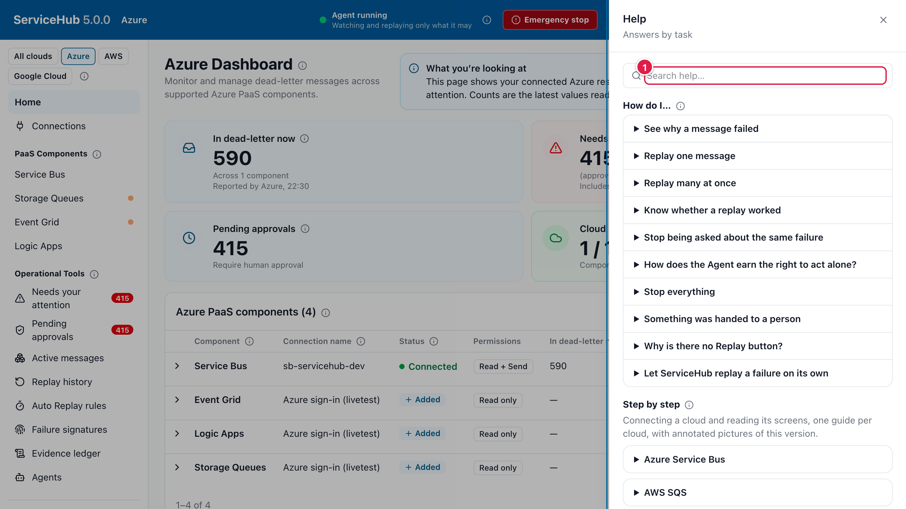

1. Search the Help. Below it: short answers by task, then the step-by-step guide for each cloud. Press ? from any page to open Help.

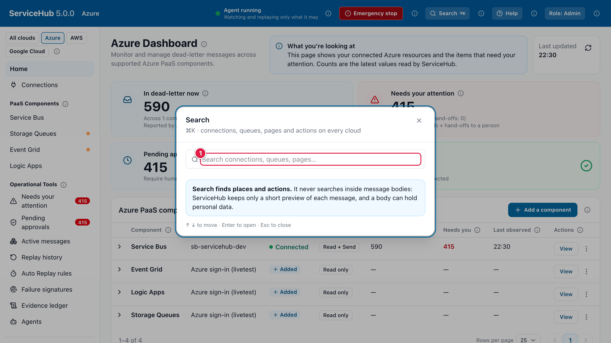

1. Search finds a connection, a queue, a page or an action from anywhere (Cmd-K or Ctrl-K). It never searches inside messages.

### 8.3 Emergency stop

Switches off everything ServiceHub does on its own. It asks for a reason and for you to type STOP. A replay a person starts still works, and anything already sent stays sent.

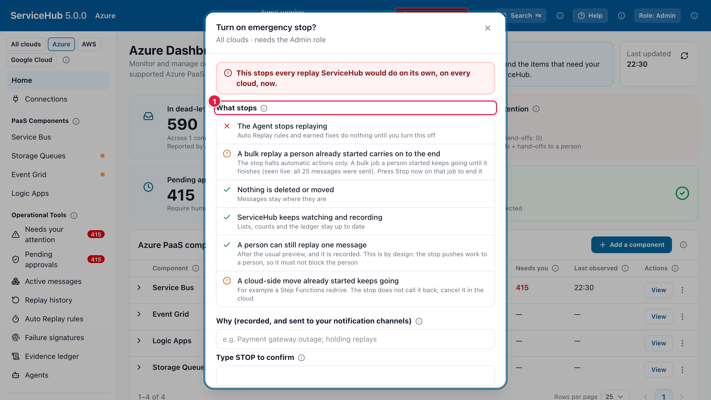

1. Exactly what stops (the Agent, automatic replays) and what does not (a replay a person starts, what is already recorded). Below: a reason, and you type STOP to confirm.

### 8.4 What ServiceHub covers

Every component on every cloud, and how far each has been proven: **Supported** (seen working against a real cloud) or **Being validated** (built, not yet proven).

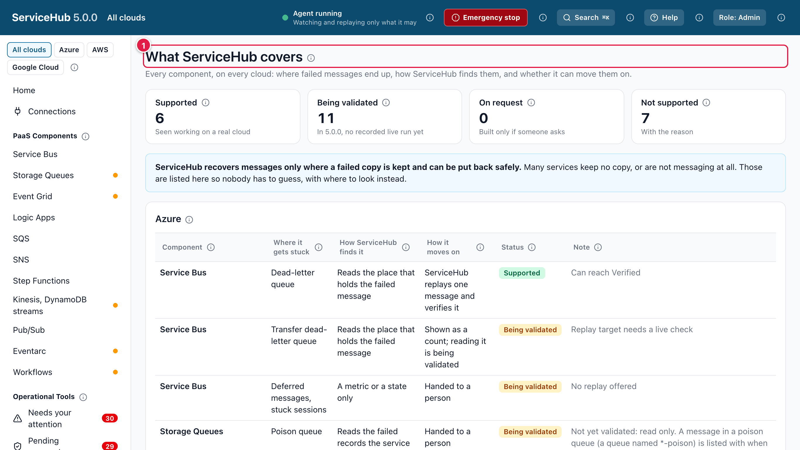

1. What ServiceHub covers: every component, per cloud, and how far each has been proven (Supported, or Being validated).

---

## If something goes wrong

- **Connect says it could not reach the namespace.** Check the connection string was copied whole (it starts `Endpoint=sb://` and includes `SharedAccessKeyName` and `SharedAccessKey`). In the portal, open **Settings → Networking** and make sure public access is allowed from where ServiceHub runs. Confirm **Local Authentication** is *Enabled* on the Overview.
- **Connect fails with 401 or says it could not list queues.** The policy is missing **Manage**. Azure only lets Manage list queues and count messages. Create a policy with Manage (which includes Send and Listen) and connect again.
- **Connect works but Replay is unavailable.** Your policy lacks **Send**. Replay needs it. A policy with **Manage** includes Send and Listen, so create one as in step 1.3 and connect again.
- **The counts differ from the portal.** Portal metrics can lag by a minute. Press **Refresh** in ServiceHub and **Refresh** in the portal; they should agree.
- **A message I replayed is not in Replay history.** Check the time window on the Replay history page (the default is the last 24 hours) and that the *Outcome* filter is *any*.

## Stopping and cleaning up

To stop ServiceHub watching Azure: **Connections**, the bin button on the connection, then typing its name to confirm. That forgets the connection and its stored credential on the ServiceHub server;
it deletes nothing in Azure. To revoke access in Azure, delete the policy under **Shared access policies**. If you created the namespace only to try
ServiceHub, delete its resource group in the portal (or run your Terraform destroy) so nothing keeps costing money.
