# ServiceHub on Google Pub/Sub — step by step, with real screenshots

> **Prefer to watch?** A captioned walkthrough of every screen, about six minutes: [Google Pub/Sub full video](../media/gcp-full.mp4). Short on time? The pain and what ServiceHub gives you, in about two minutes: [short video](../media/gcp-short.mp4).

This guide takes you from nothing to a working ServiceHub on **Google Cloud Pub/Sub**, one screen at a time. Every picture is the real
application (or the real Google Cloud console) — not a mock-up — with numbered markers; the numbered list under each picture says what that control
does **and what it will not do**. Account names and key ids are blanked out in the console pictures.

**What you will do**

1. In the Google Cloud console, make a service account just for ServiceHub, give it only the Pub/Sub roles it needs, and download a key.
2. Connect Google Cloud in ServiceHub and check it can see your topics and subscriptions.
3. Ask ServiceHub to look at the dead letters, understand them, and replay one safely.
4. See what ServiceHub can and cannot prove on Google Cloud, and learn what Auto Replay, the Evidence ledger and Configuration show.

**What you need**

| You need | Why |
|---|---|
| A project with Pub/Sub **topics and subscriptions**, ideally with a **dead-letter policy** on the subscription | Failed messages are forwarded to a dead-letter topic; ServiceHub reads that topic's subscription |
| Permission to create a service account and a key in the project | You will make a ServiceHub-only credential. Some organisations forbid service-account keys by policy: see the troubleshooting list |
| ServiceHub running (see the README) | You will open it in a browser |

> **Cost, and what is different on Google Cloud.** Pub/Sub has no way to look at a message without *pulling* it, and every pull counts as a
> delivery attempt. So ServiceHub **never looks on its own**: it reads dead letters only when you press **Look now** (up to 100 per queue, handed
> straight back, and it can take up to a minute per queue). It does not browse your active messages at all. Pub/Sub also reports **no message
> counts**, **no failure reason** and **no delivery count**, so ServiceHub says "can't count here" or "reason not recorded" instead of guessing.
> Normal Pub/Sub charges apply; ServiceHub adds none of its own.

**The roles to give the service account** (Pub/Sub only; nothing else in your project is reachable):

| Role | Where | Why |
|---|---|---|
| `roles/pubsub.viewer` | The project | List your topics and subscriptions |
| `roles/pubsub.subscriber` | Your subscriptions (including the dead-letter one) | Pull to look, hand a message back, remove the dead-letter copy on replay |
| `roles/pubsub.publisher` | Your topics (including the dead-letter topic) | Put a replayed message back — used only when you replay |

Granting the three roles on the whole project also works and is simpler; granting `subscriber` and `publisher` on just the resources above is tighter.

---

## Part 1 — In the Google Cloud console

*Do these first. Each step shows the real console.*

### 1.1 Look at your topics and subscriptions

Sign in to the Google Cloud console, pick your project (note its **Project ID**, not its name) and open **Pub/Sub**. **Topics** lists where messages are published; **Subscriptions** lists who reads them. A queue in ServiceHub is a subscription together with its topic.

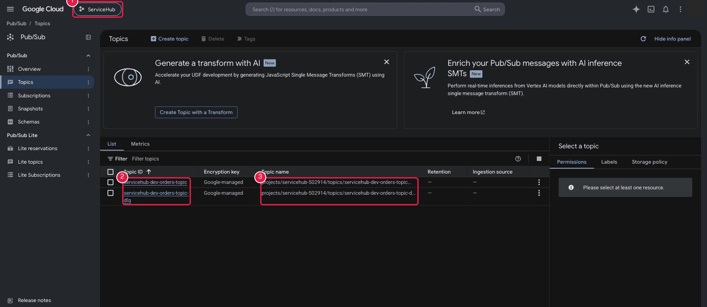

1. Project picker — shows the project you are in. ServiceHub needs its Project ID, which is the part after projects/ in a topic's full name below (not the project's display name).
2. Topic IDs — where messages are published. ServiceHub finds every topic in the project; you do not list them.
3. Topic name — the full path. The part after projects/ is your Project ID, the first thing you type into ServiceHub.

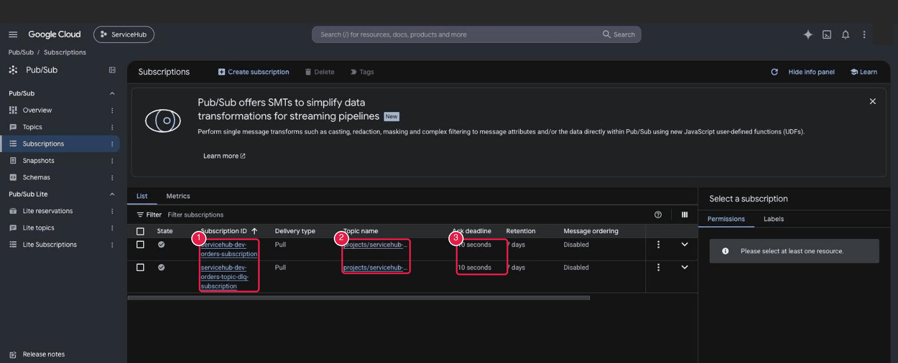

1. Subscription IDs — a queue in ServiceHub is a subscription together with its topic. The one ending -dlq-subscription holds your dead letters.
2. Topic — the topic each subscription reads from.
3. Ack deadline — how long a reader has to acknowledge a message before Pub/Sub delivers it again. ServiceHub hands a looked-at message straight back, so it never waits this out.

### 1.2 Find the dead-letter policy

Open your main subscription and look at **Dead lettering**. It names the dead-letter topic and the **Maximum delivery attempts** — how many tries before Pub/Sub forwards a message there. The dead-letter topic needs its own subscription, or forwarded messages are not kept: that subscription is what ServiceHub reads as your dead letters.

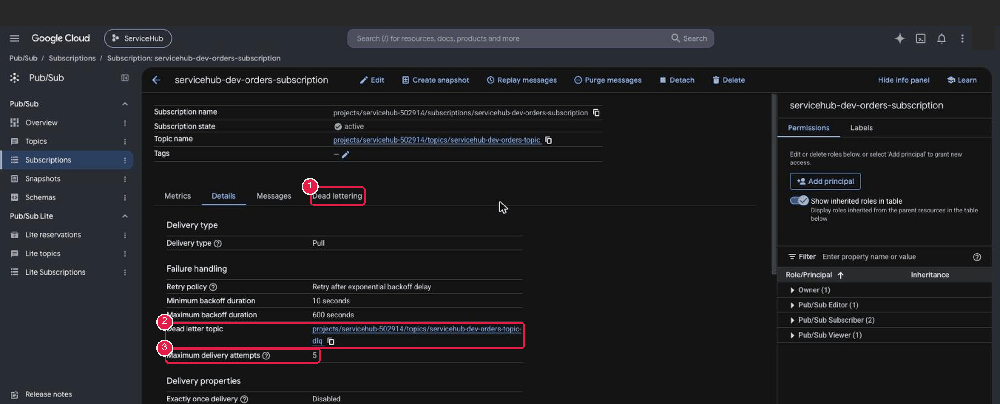

1. Dead lettering — the tab for the same policy, where you can change it.
2. Dead letter topic — where Pub/Sub forwards a message after it fails too often. ServiceHub reads this topic’s own subscription as your dead letters.
3. Maximum delivery attempts — after this many failed tries Pub/Sub forwards the message. Reading a dead letter from ServiceHub counts as one more attempt, which is why ServiceHub only looks when you ask.

### 1.3 Create a ServiceHub-only service account

Open **IAM & Admin → Service accounts → Create service account**. Name it (we use `servicehub-app`) and skip the optional role steps for now. Do not use your own account or the default compute account: a separate account can be switched off later without disturbing anything else.

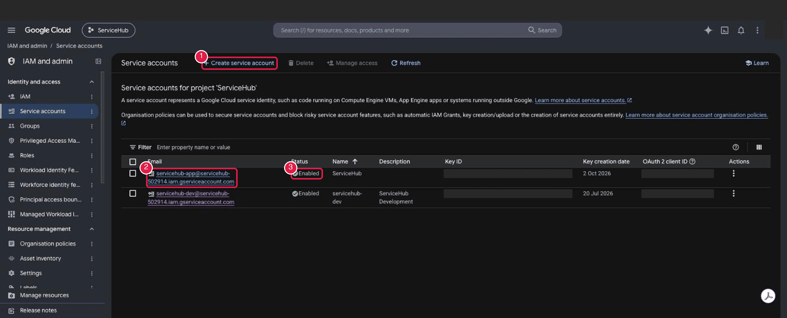

1. Create service account — start here to make an account just for ServiceHub, not your own.
2. The ServiceHub account — separate from your own and from the accounts your applications use, so you can switch it off later without disturbing anything else.
3. Status — Enabled. Disabling or deleting the account cuts ServiceHub off.

### 1.4 Give it only the Pub/Sub roles it needs

Grant the three roles from the table at the start of this guide: **Pub/Sub Viewer** on the project (IAM page), and **Pub/Sub Subscriber** and **Pub/Sub Publisher** on your subscriptions and topics (each resource's **Permissions** panel) — or all three on the project if you prefer one step. If the key ever leaked, it could touch nothing outside Pub/Sub.

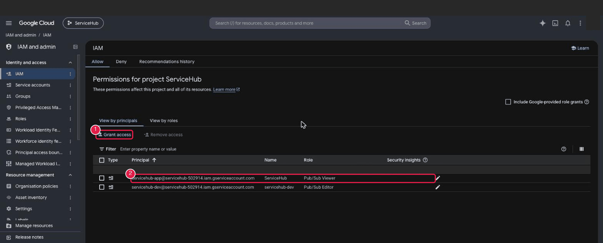

1. Grant access — where you give an account a role on the whole project.
2. The ServiceHub account with Pub/Sub Viewer on the project — it lets ServiceHub list your topics and subscriptions. Pub/Sub Subscriber and Pub/Sub Publisher are granted on the individual subscriptions and topics (next screenshot).

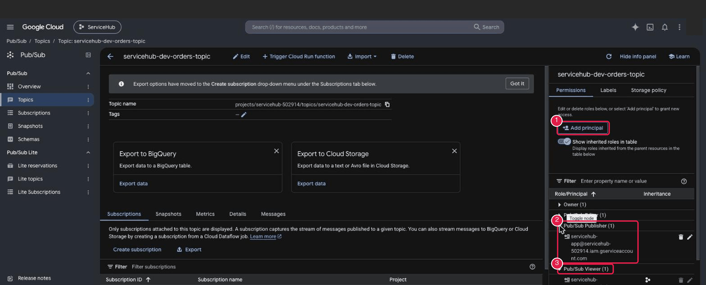

1. Add principal — grants a role on just this topic. Do the same on each subscription for Pub/Sub Subscriber.
2. Pub/Sub Publisher — granted to the ServiceHub account on this topic only. It is used to put a replayed message back.
3. Pub/Sub Viewer — inherited from the project, so the account can see this topic.

### 1.5 Create a key

Open the service account, then **Keys → Add key → Create new key → JSON**. A file downloads — **Google shows its private key only once**. Treat the file like a password: ServiceHub encrypts it on arrival and never shows it again, but anyone who has it can use it. Disabling or deleting the key is how you revoke access later.

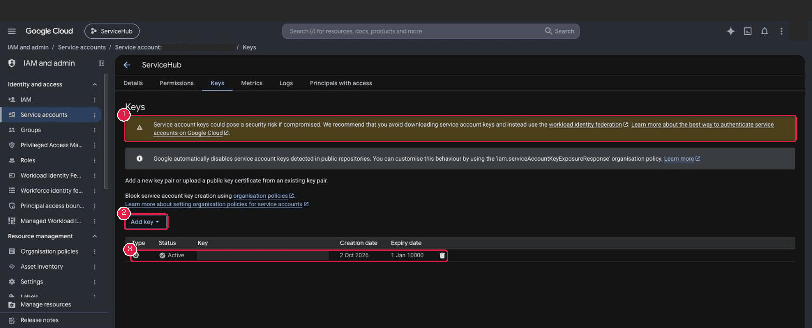

1. Google’s reminder that keys are a risk if they leak. Treat the file like a password, and delete the key when you no longer need it.
2. Add key → Create new key → JSON — downloads the key file ServiceHub needs. Google shows the private key only once.
3. The key — Active. The bin deletes it, which is how you revoke ServiceHub’s access later.

## Part 2 — Connect Google Cloud in ServiceHub

*About two minutes. You only do this once.*

### 2.1 The Connections page

Open **Connections** in the left menu. This is the list of every cloud ServiceHub can read, grouped by cloud. Each row says whether the last test passed, which components are switched on, and has **Test**, **Add a component** and a remove (bin) button. Press **Connect a cloud** to add one.

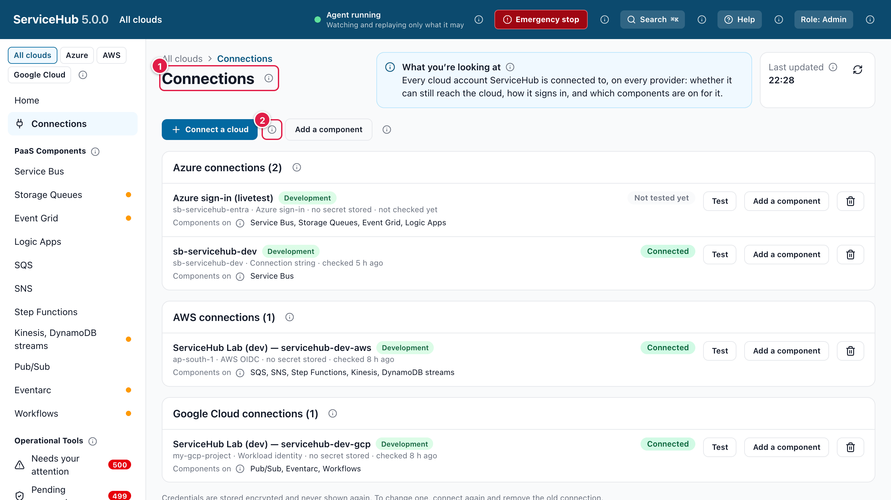

1. Every cloud ServiceHub is connected to. Connecting is how ServiceHub gets read access to your queues and topics.
2. Connect a cloud opens the connect window. Your credentials are encrypted before they are stored and never shown again.

### 2.2 Fill in the connect window

Choose the **Google Pub/Sub** tab. Give it a name, keep the environment as **Development**, choose **Read and send** (replay needs publish), enter the **Project ID** (the ID, not the name or number) and choose the service-account **key file (.json)** you downloaded in Part 1. Nothing is saved until you press **Connect**; ServiceHub then tests the credential, and stores it encrypted (AES-256-GCM). It is never shown again.

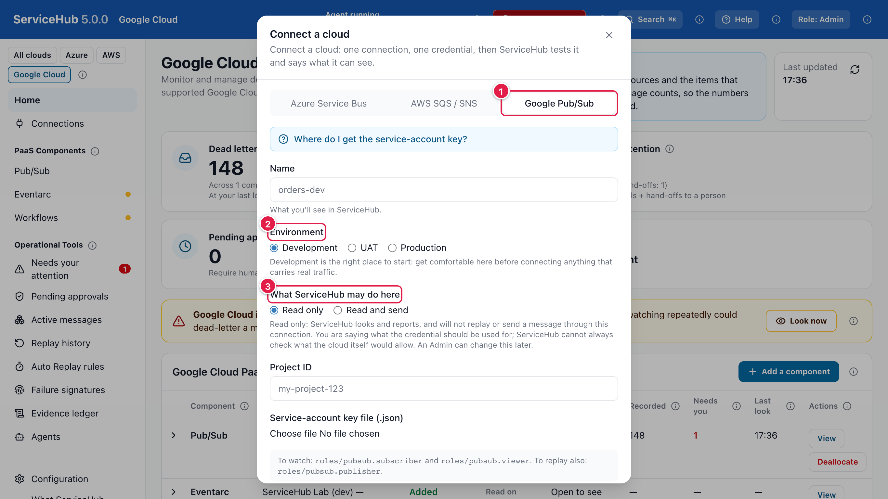

1. Pick the cloud. This guide uses Google Cloud.
2. Say what this connection is: Development, UAT or Production. Start with Development. Production gets the strictest rules.
3. Read only, or Read and send. Read only means ServiceHub can look and can never replay on this connection. Nothing is saved until you press Connect, at the bottom of this window.

### 2.3 Tick the components you want

After connecting, **Add a component** lets you tick other Google Cloud services on the same connection (for example Eventarc and Workflows). Each one's access is checked first, read-only, before it is added. Unticking removes it from the menu and keeps every record it produced. A small amber dot beside a component in the menu means it has been built but not yet proven against a real cloud.

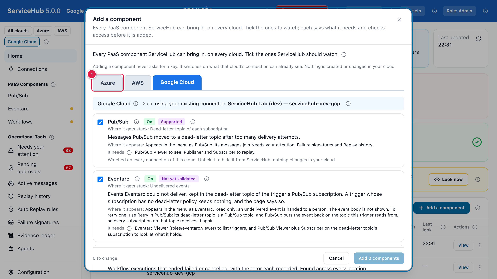

1. Add a component: pick the cloud, then tick each service to list its failed runs or dead-lettered events. Access is checked first, read-only. Unticking keeps every record it produced.

## Part 3 — Learn the screens

*Two minutes of orientation so nothing is a surprise.*

### 3.1 All clouds: Home

The first page. The four tiles say what **needs your attention**, how many replays are **pending approval**, what is dead-lettered, and how many clouds are connected. Below them each cloud has its own card. ServiceHub deliberately shows **no total across clouds**: one cloud counts exactly, one approximately, one not at all, so adding them would give a number that means nothing.

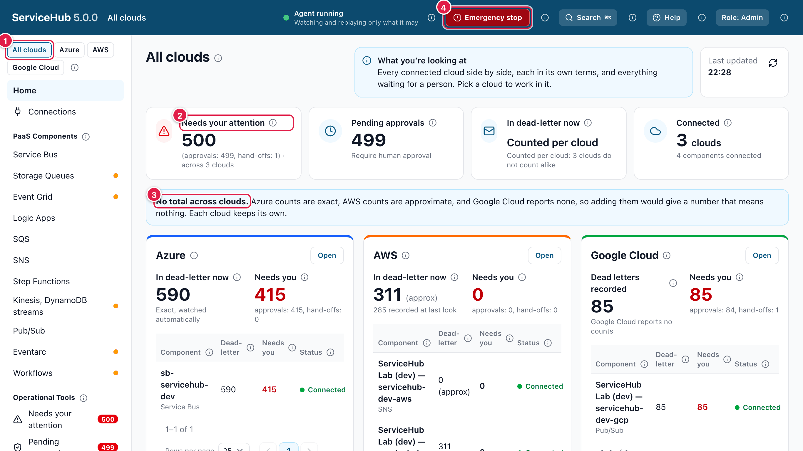

1. The cloud switcher. All clouds shows every connection side by side; Azure, AWS and Google Cloud narrow every page to one cloud. The cloud is also in the address, so a link shows someone exactly what you see.
2. What is waiting for a person across the clouds you connected. It is the number to watch.
3. ServiceHub does not add the clouds together: one counts exactly, one approximately, one not at all, so a sum would mean nothing. Each cloud keeps its own number.
4. Emergency stop. Switches off everything ServiceHub does on its own. It does not touch a replay a person starts.

### 3.2 Google Cloud: Home and the menu

Pick **Google Cloud** in the cloud switcher (top left). The cloud is part of the address, so a link shows someone exactly what you see. The menu has three groups: **PaaS Components** (the Google Cloud services ServiceHub reads), **Operational Tools** (the pages you use every day, the same on every cloud) and **Configuration** with **What ServiceHub covers** at the bottom. The bar on top shows whether the Agent is running, and holds **Emergency stop**, **Search** and **Help**.

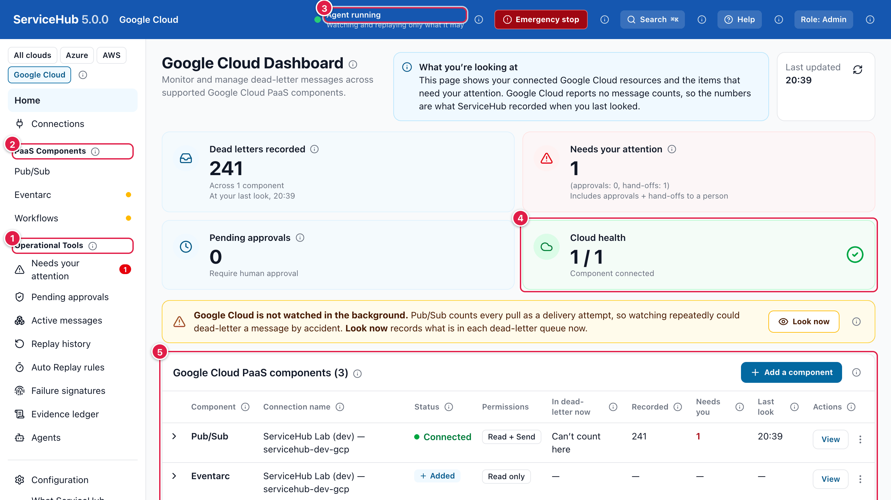

1. Operational Tools: the pages you use every day, the same for every cloud. Start with Needs your attention.
2. The Google Cloud services ServiceHub can read. An amber dot means a component has not been proven against a real cloud yet.
3. The Agent is on. It watches and only replays what it has earned the right to. Hover the (i) beside it to see exactly what it may do.
4. Cloud health: how many of this cloud’s components ServiceHub can reach right now.
5. Every component you connected, whether it is reachable, what ServiceHub may do on it (Read only, or Read + Send), what is dead-lettered and what needs you. View opens it; the three dots hold Deallocate.

## Part 4 — Find and replay a dead-lettered message on Google Cloud

*The core loop: find it, understand it, replay it with a preview, check it held.*

### 4.1 Open the connection

In the menu choose **Pub/Sub**, then your connection. The **Overview** says how many messages are dead-lettered now (Google Cloud reports no counts to ServiceHub, so it shows what it has recorded), and lists every topic and subscription. The tabs are: **Dead-letter messages**, **Recovery** (what was replayed and whether it held), **Access** (what ServiceHub may do here), **Configuration** and **Audit**.

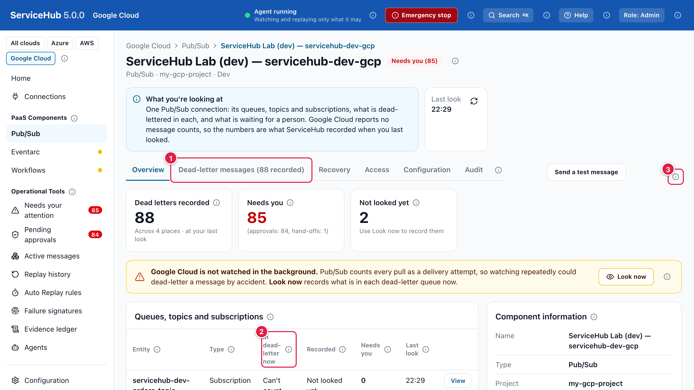

1. The tabs of this connection. Dead-letter messages is where you read and replay; Recovery shows what was replayed and whether it held; Access shows what ServiceHub may do here; Audit is every action.
2. How many messages are dead-lettered right now, and whether the number is exact or approximate on this cloud.
3. Sends one harmless test message to a queue you choose, so you can watch it travel. Optional.

### 4.2 Look now (Google Cloud is not watched in the background)

Pub/Sub reports no counts, and pulling a message counts as a delivery attempt. So ServiceHub **never looks on its own**. On the **Dead-letter messages** tab a yellow strip says so, and **Look now** records what is in each dead-letter subscription right now. Google Cloud often records **no reason** for a dead letter; when it does not, the table says so once instead of showing a column of dashes. Press **Look now** once and wait.

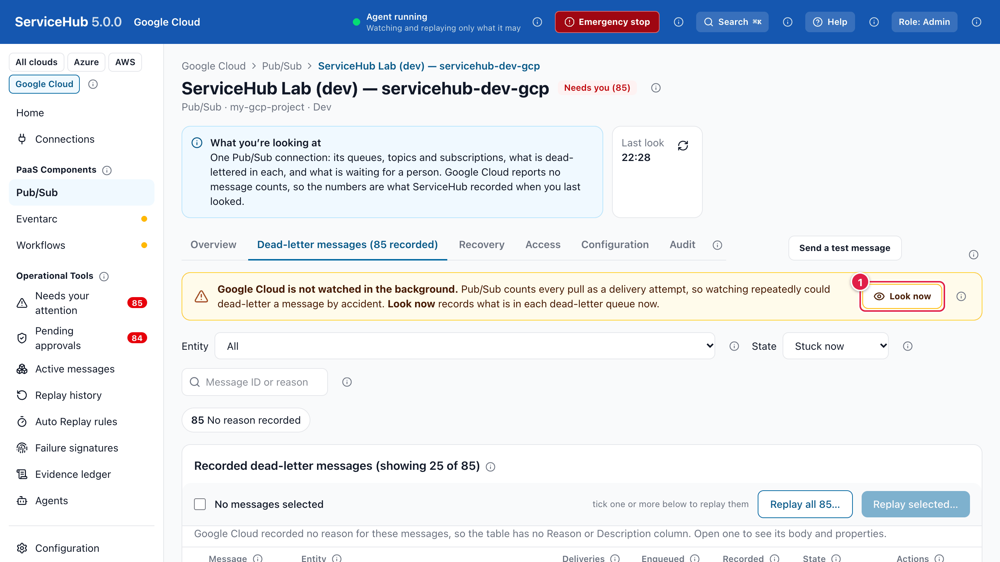

1. Google Cloud is not watched in the background: there is no safe way to count dead letters without a delivery attempt. Look now records what is in the dead-letter queues right now, once, never faster than the cloud allows.

### 4.3 The Dead-letter messages tab

Every dead-lettered message on this connection. Group chips above the table count them by reason. Filter by queue or state, or search by message id or reason (never inside bodies). Tick one or more messages and press **Replay selected…**; a preview opens first. Press **Open** on a row to read one.

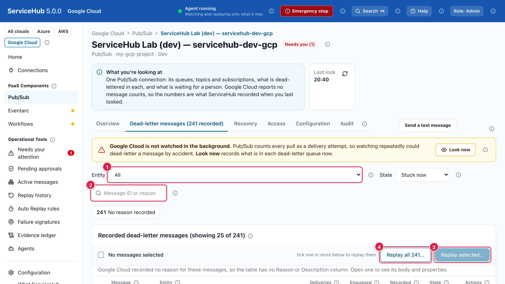

1. Filter by queue, topic or state (Stuck now, No longer stuck, all).
2. Search by message id or by the reason it failed. It never searches inside message bodies.
3. Tick one or more messages, then Replay selected. A preview opens first; nothing is sent until you confirm.
4. Replay all N… opens the preview of every message that matches the filters (at most 500 in one replay, so it says "first 500" when more match). Nothing is sent until you confirm in the preview.
5. Open one message to read why it failed, its body and its history.

### 4.4 Open a message

A side window opens beside the list. **Why it failed** gives the reason, the description, how many times it was tried, and how many others failed the same way. **Body**, **Properties** and **History** are the message exactly as stored. ServiceHub never changes a body. **Replay…** is at the bottom of the window.

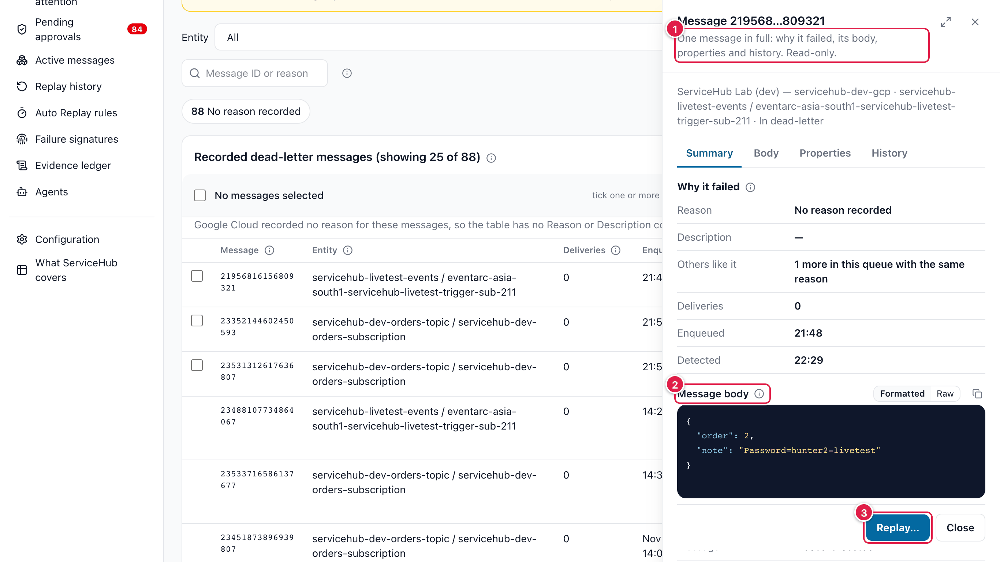

1. The reason and description the cloud recorded, and how many others failed the same way.
2. The message exactly as it was sent. ServiceHub never changes a message body.
3. Replay… opens the preview. It is always a preview first.

### 4.5 The replay preview

Nothing is sent yet. The preview shows the message, where it would go back to, and the safety checks that ran. **Replay 1 message** is the only button that changes anything. Cancel closes it.

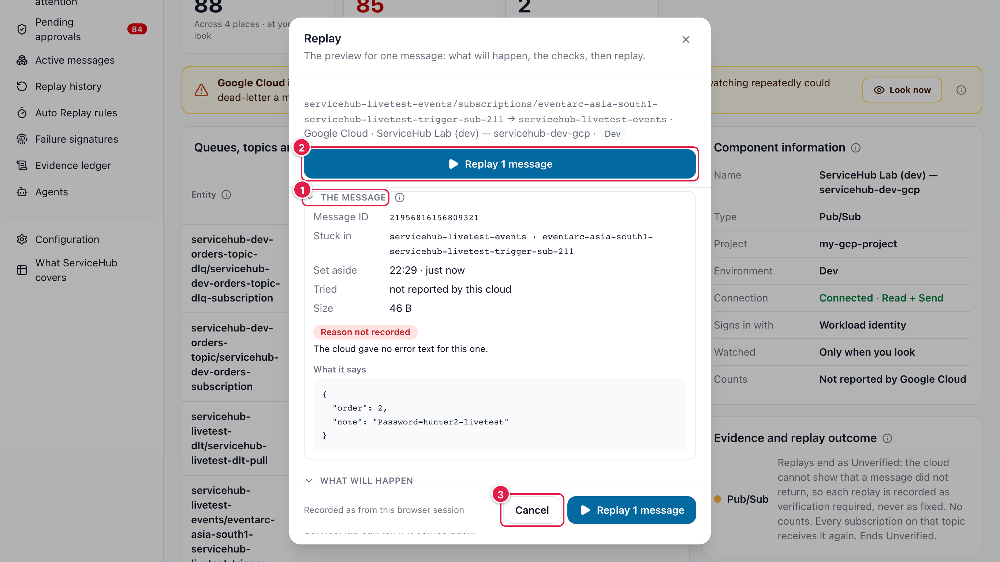

1. The message that would be replayed, exactly as it is stored, and where it would go back to.
2. Replay 1 message sends it back. This is the only button that changes anything, and ServiceHub then watches whether the fix held.
3. Cancel closes the preview. Nothing has been sent.

### 4.6 The result, and whether it held

After **Replay 1 message** the window says **Sent back**: the message is published to its topic again (every subscription on that topic receives it again, which the preview says), and, on Google Cloud, that the result will read **Verification required**. Pub/Sub cannot show that the dead-letter subscription stayed empty, so ServiceHub cannot call it fixed. In **Replay history** it appears as **Unverified**. To get Verified and Came back, open the connection's **Configuration** tab and switch on **Confirm fixes on this cloud**.

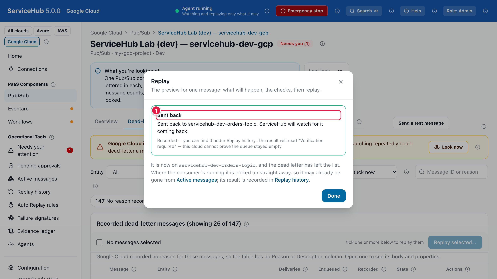

1. The result, in plain words: the message is back on its queue and the dead letter has left the list. Sent back is not the same as fixed. ServiceHub now watches it, and marks it Verified or Came back.

## Part 5 — When ServiceHub asks you

*The Agent never replays what it has not earned. When it is unsure it stops and asks.*

### 5.1 Needs your attention

Everything on this cloud waiting for a person: replays the Agent is holding, and items ServiceHub handed off. The four tiles count them and show the oldest. Filter by component, family or age; **Review** opens the decision.

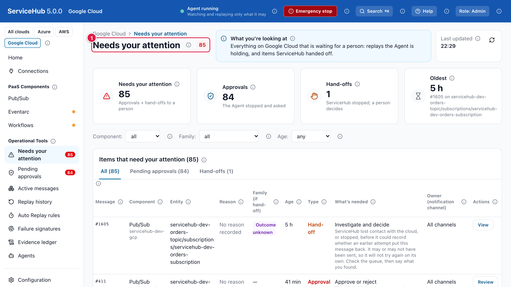

1. Everything on this cloud that waits for a person: replays the Agent is holding, and items ServiceHub handed off. Review opens the decision.

### 5.2 Pending approvals

The held replays on their own. Each row says which failure it was and why the Agent stopped (usually: this kind of failure has not yet earned automatic replay, so a person decides). Approving needs the **Approver** role.

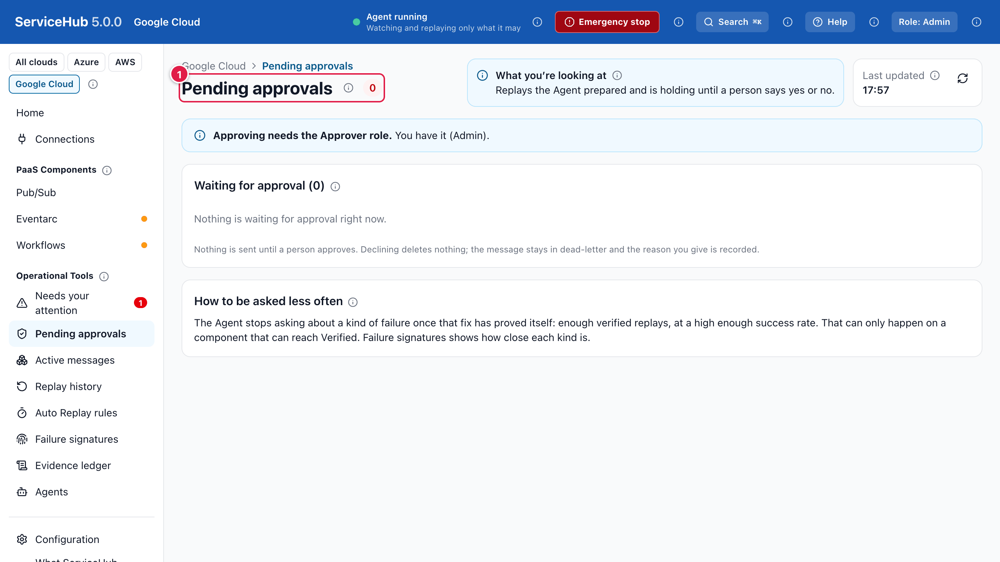

1. Replays the Agent stopped on because this kind of failure has not yet earned automatic replay. You approve or decline each, and the answer is recorded.

### 5.3 Review: approve or decline

Review explains why the Agent stopped, lists the messages that would be replayed, and offers **Approve** or **Decline…**. Declining needs a reason. Both answers are written to the evidence ledger.

## Part 6 — Afterwards

*A replay is not finished when it is sent. ServiceHub watches what happens next.*

### 6.1 Replay history

Every replay, who or what started it, how many messages, and what ServiceHub saw afterwards: **Verified** (did not come back), **Watching** (still inside the window), **Came back** (failed again, so it is not fixed) or **Unverified** (sent, but this cloud cannot prove it held).

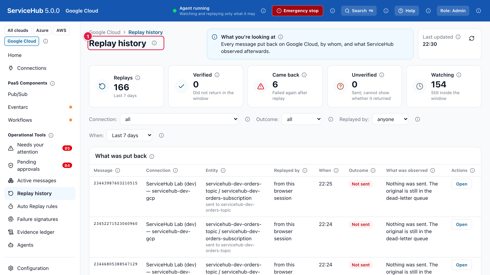

1. Every replay: who or what started it, how many messages, and the outcome ServiceHub saw afterwards (Watching, Verified, Came back, Unverified).

### 6.2 Active messages

The live queues, not the dead-letter ones. Read-only: it exists so you can see whether things are moving. Browse opens a queue's messages without changing them.

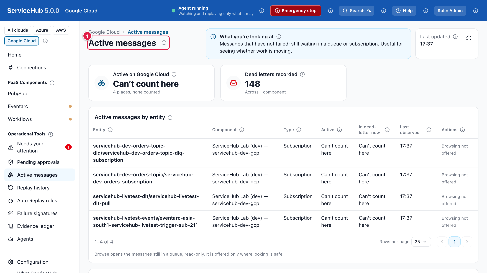

1. Messages in the live queues now, not the dead-letter queues. Read-only.

### 6.3 Failure signatures

Failures grouped by how they fail, so a thousand messages become a handful of causes. For each: how many are stuck, whether replaying has helped before, and how much the Agent may do about it (its level of trust).

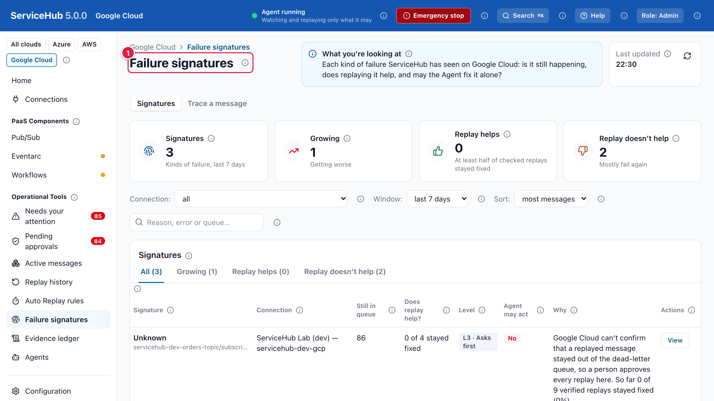

1. Failures grouped by how they fail, so a thousand messages become a handful of causes.

## Part 7 — Letting the Agent help

*Optional, and earned. Nothing is automatic until you create a rule and the failure has a record of verified fixes.*

### 7.1 Auto Replay rules

A rule says: for this failure pattern, replay on your behalf, at this pace. A rule that has not earned trust only produces approvals. If results turn bad it switches itself off and asks a person.

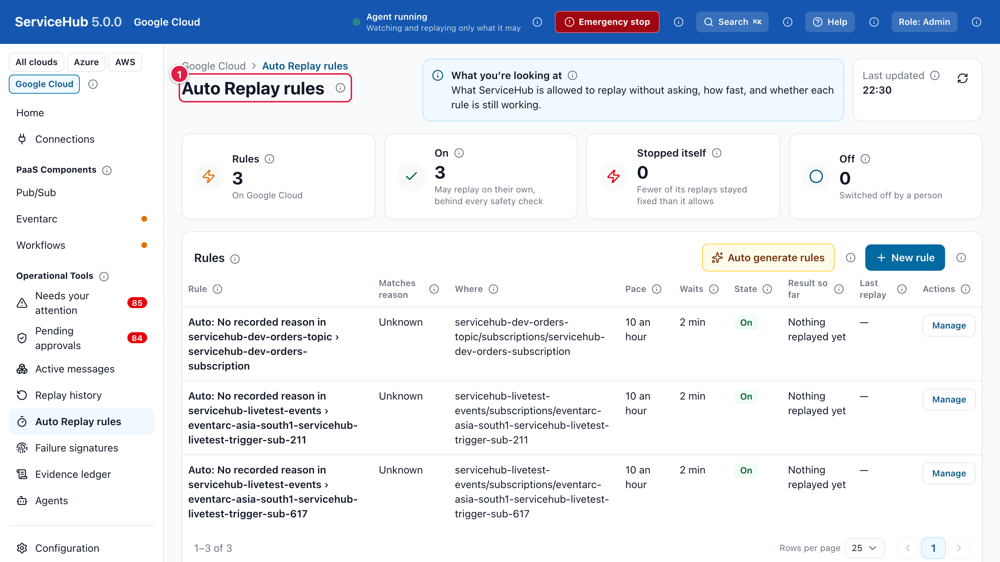

1. What the Agent may replay by itself. A rule is on only for a failure pattern that has earned it; it stops and asks a person when results turn bad.

### 7.2 Agents

The background workers: what each one does, whether it is healthy, when it last ran, and whether it may act or only observe. Pause any of them from here.

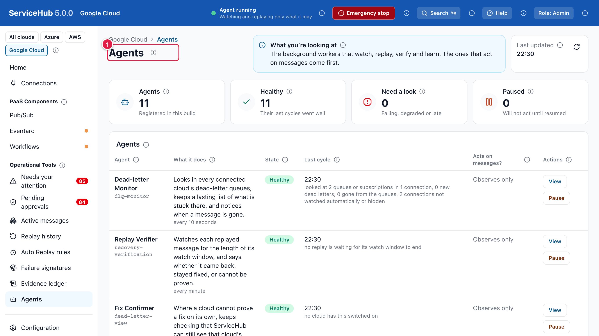

1. The background workers: what each does, when it last ran and whether it is healthy.

### 7.3 Evidence ledger

A tamper-evident record of every decision ServiceHub took, with who or what took it. Each entry is chained to the one before; export it and check it offline with `scripts/verify-recovery-chain.py`.

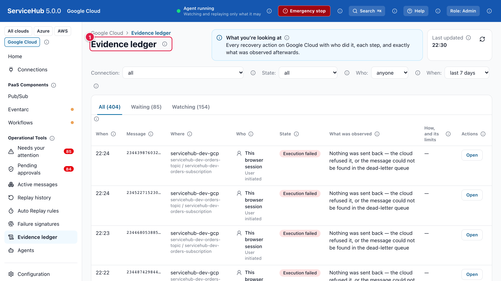

1. The tamper-evident record of every decision. Export it and check it offline with verify-recovery-chain.py.

## Part 8 — Configuration, Help and safety

*Where the rest lives.*

### 8.1 Configuration

How ServiceHub looks (**Preferences**), who may do what (**Access**), **Notifications**, **Backup** and restore, and the list of **Connections** again, with each cloud's own settings.

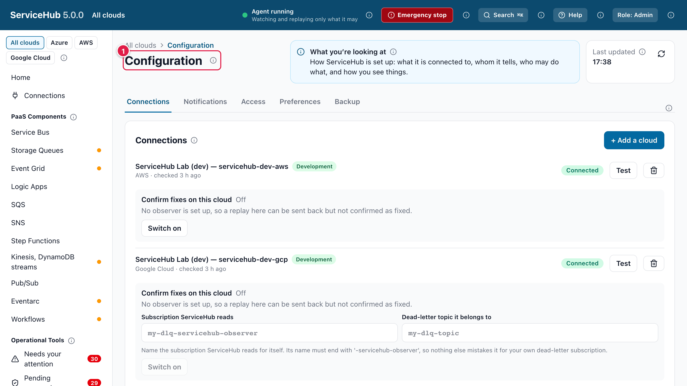

1. Configuration: how ServiceHub looks, who may do what, backup and restore, and notifications.

### 8.2 Help and Search

**Help** (or press `?`) has answers by task, the step-by-step guides, and the keyboard shortcuts. **Search** (Cmd-K or Ctrl-K) finds a connection, a queue, a page or an action; it never searches inside messages.

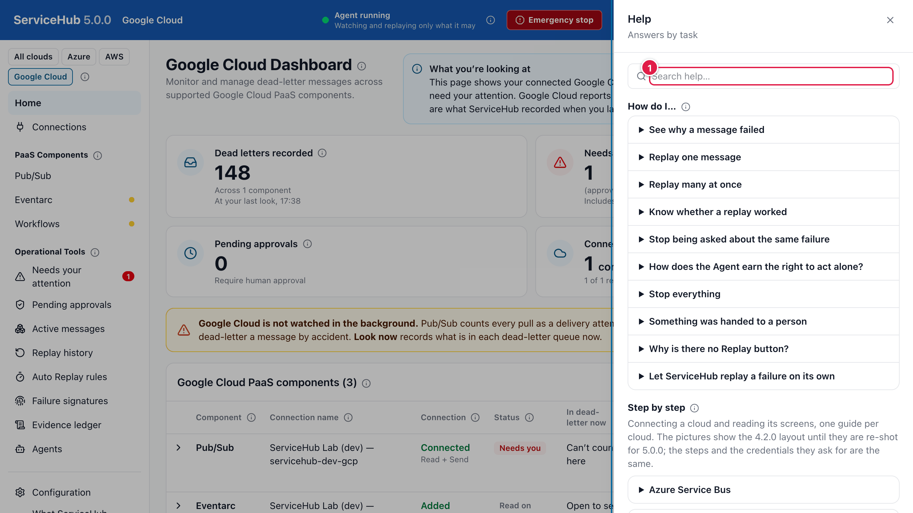

1. Search the Help. Below it: short answers by task, then the step-by-step guide for each cloud. Press ? from any page to open Help.

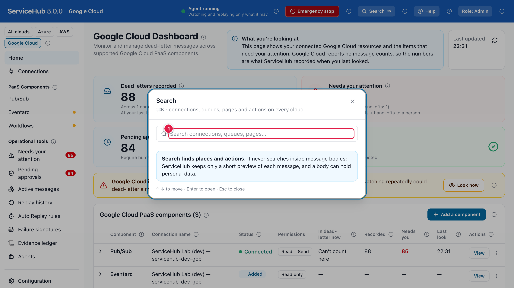

1. Search finds a connection, a queue, a page or an action from anywhere (Cmd-K or Ctrl-K). It never searches inside messages.

### 8.3 Emergency stop

Switches off everything ServiceHub does on its own. It asks for a reason and for you to type STOP. A replay a person starts still works, and anything already sent stays sent.

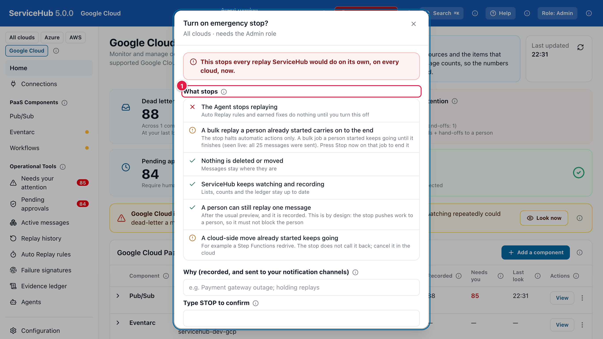

1. Exactly what stops (the Agent, automatic replays) and what does not (a replay a person starts, what is already recorded). Below: a reason, and you type STOP to confirm.

### 8.4 What ServiceHub covers

Every component on every cloud, and how far each has been proven: **Supported** (seen working against a real cloud) or **Being validated** (built, not yet proven).

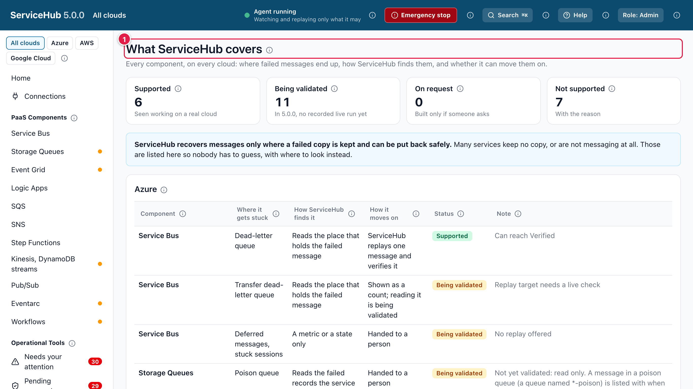

1. What ServiceHub covers: every component, per cloud, and how far each has been proven (Supported, or Being validated).

---

## If something goes wrong

- **Connect says the key is invalid, or could not authenticate.** Check you chose the whole JSON file the console downloaded for the ServiceHub service account (it contains `"type": "service_account"` and a `private_key`), and that the key is still **Enabled** (IAM & Admin → Service accounts → the account → Keys). A key cannot be downloaded again: if you lost the file, create a new key.
- **Connect works but finds no topics or subscriptions.** Check the **Project ID** — it is the ID, not the project name or number — and that the service account has **Pub/Sub Viewer** on that project.
- **Creating the key is blocked.** Your organisation may enforce the policy *Disable service account key creation* (`iam.disableServiceAccountKeyCreation`). Ask an administrator for an exception for this project, or use a project where it is allowed.
- **Dead letters stays empty after Look now.** The dead-letter subscription may really be empty, or there may be no subscription on the dead-letter topic (forwarded messages are dropped without one), or the service account lacks **Pub/Sub Subscriber** on it.
- **Replay is unavailable or refused.** The service account lacks **Pub/Sub Publisher** on the topic (to put the copy back) or **Pub/Sub Subscriber** on the subscription (to remove the dead-letter copy).
- **Look now or Replay takes a long time.** Pub/Sub has no way to fetch one message by id, so ServiceHub pulls until it finds it; with a long dead-letter queue this can take up to a minute. Keep the window open — nothing is lost if you leave.
- **The counts say “can't count here”.** Pub/Sub reports no message counts to ServiceHub. That is the cloud, not a fault: ServiceHub shows what it has recorded instead.
- **Why does every replay say “Verification required”?.** ServiceHub can prove a fix held only where the cloud can show the dead-letter queue stayed empty. Google Cloud cannot, so ServiceHub records the replay honestly instead of calling it fixed.

## Stopping and cleaning up

To stop ServiceHub watching Google Cloud: **Connections**, the bin button on the connection, then typing its name to confirm. That forgets the connection and its stored credential on the ServiceHub server;
it deletes nothing in Google Cloud. To revoke access in Google Cloud, disable or delete the key (IAM & Admin → Service accounts → the account → Keys), and delete the
service account and its role grants if you no longer need them. If you created the topics only to try ServiceHub, delete them in Pub/Sub so nothing keeps costing money.
